# Social: 21.11 – 27.11

Φτιάχνεται μόνο του μετά από κάθε ενημέρωση του προγράμματος (social.yml), οπότε δείχνει πάντα τις τελευταίες ώρες και αλλαγές. Στο iPhone (Safari): πάτα μια εικόνα, κράτα το δάχτυλο πάνω της → «Προσθήκη στις Φωτογραφίες».

## Παρασκευή 20.11

### 09:00 · ⭕ Story: Σήμερα παίζει

Sticker «Σύνδεσμος» → paokalendar.gr

<a href="https://raw.githubusercontent.com/GabrielChatzi/PAOK-calendar/social/img/2026-11-20-story.png">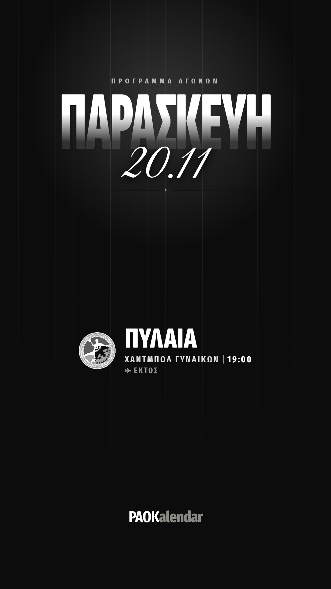</a>

### 21:00 · 📸 Post ⬜: Αποτελέσματα της εβδομάδας

<a href="https://raw.githubusercontent.com/GabrielChatzi/PAOK-calendar/social/img/2026-11-18_2026-11-20-apotelesmata-post.png">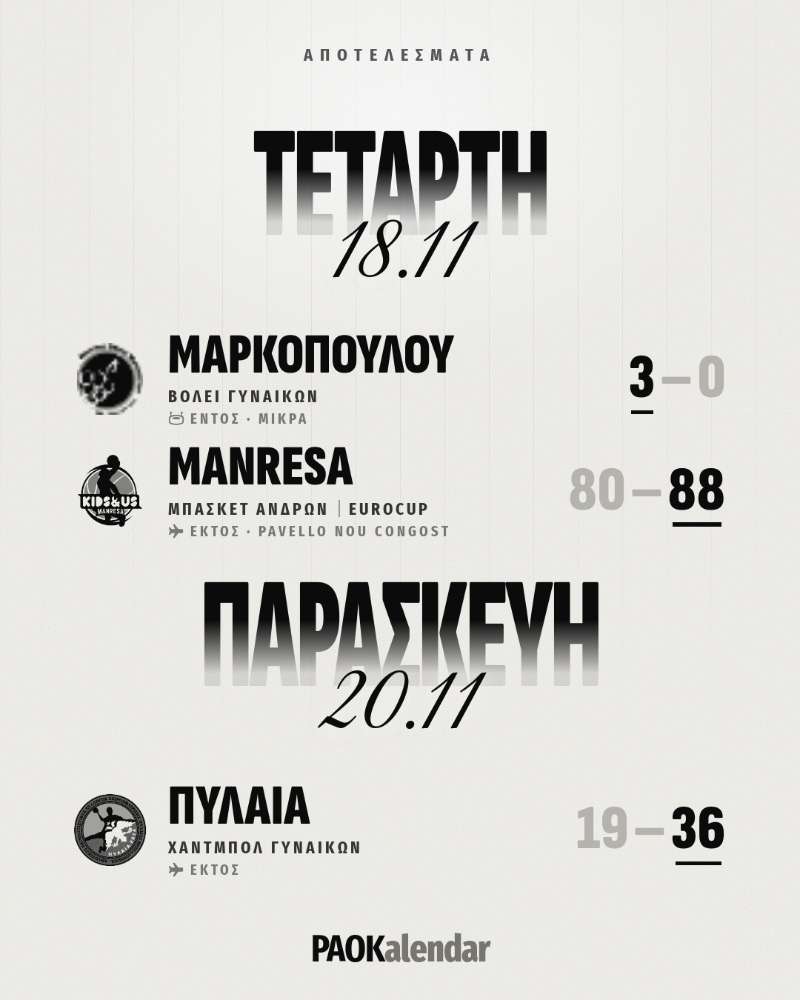</a>

```
Τα αποτελέσματα της εβδομάδας ⚪️⚫️
3 νίκες σε 3 αγώνες.

Όλα τα σκορ και οι βαθμολογίες: paokalendar.gr (link στο bio)

#ΠΑΟΚ #PAOK #PAOKalendar
```

### 21:00 · ⭕ Story: Αποτελέσματα ημέρας

<a href="https://raw.githubusercontent.com/GabrielChatzi/PAOK-calendar/social/img/2026-11-20-apotelesmata-story.png">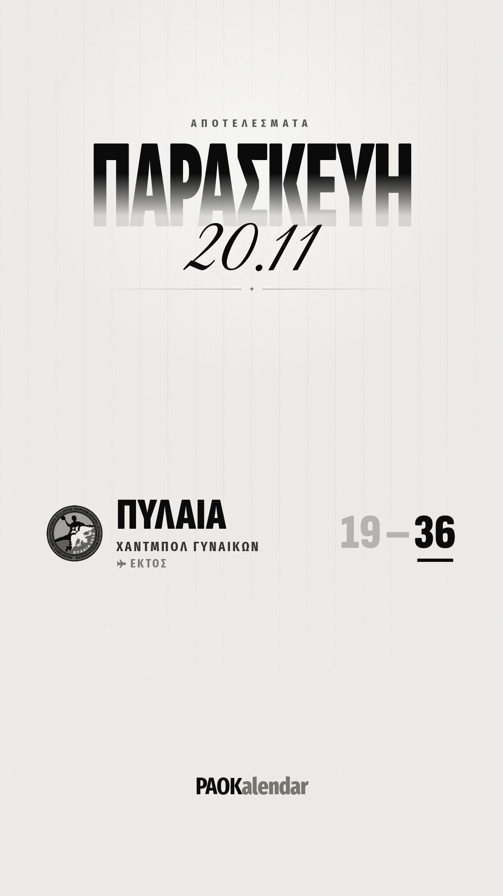</a>

### 21:30 · 📸 Post ⬛: Πρόγραμμα του Σαββατοκύριακου

<a href="https://raw.githubusercontent.com/GabrielChatzi/PAOK-calendar/social/img/2026-11-21-post.png">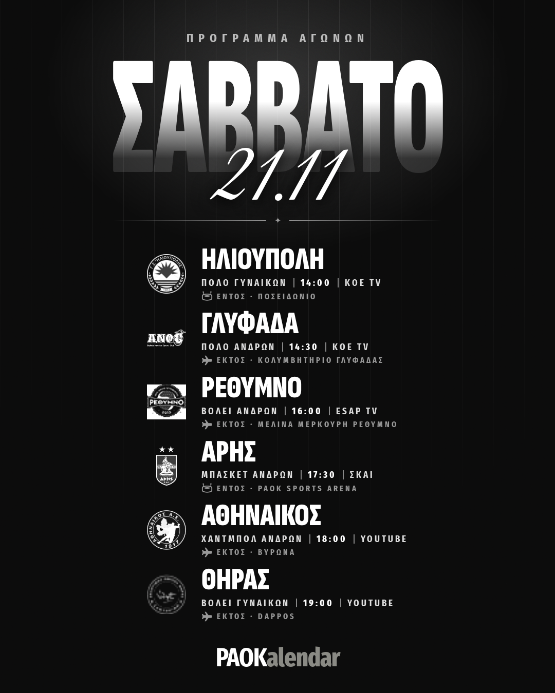</a> <a href="https://raw.githubusercontent.com/GabrielChatzi/PAOK-calendar/social/img/2026-11-22-post.png">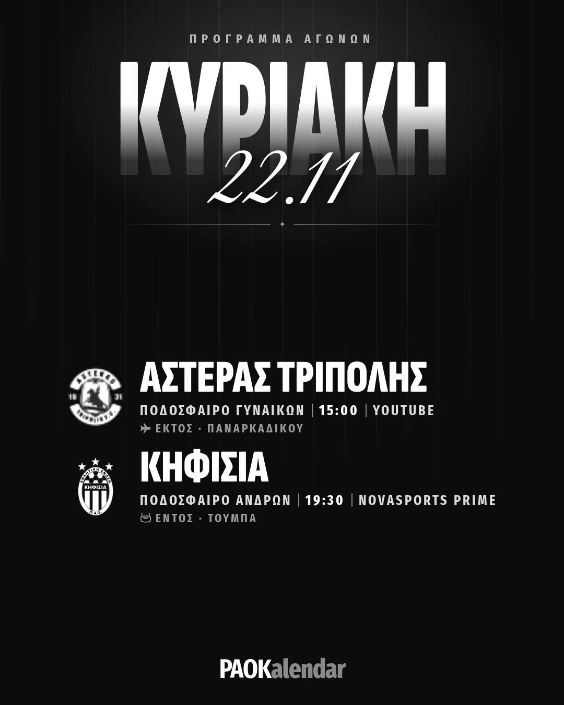</a> <a href="https://raw.githubusercontent.com/GabrielChatzi/PAOK-calendar/social/img/2026-11-23-post.png">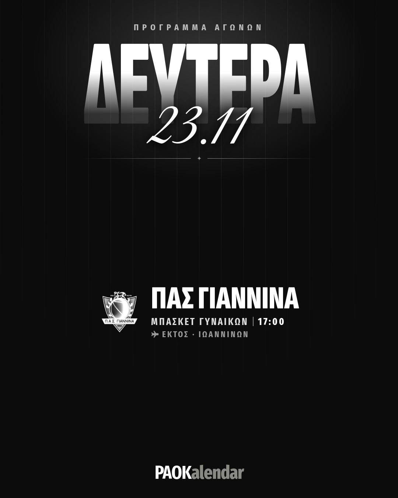</a> <a href="https://raw.githubusercontent.com/GabrielChatzi/PAOK-calendar/social/img/akadimies-2026-11-21-football-1-post.png">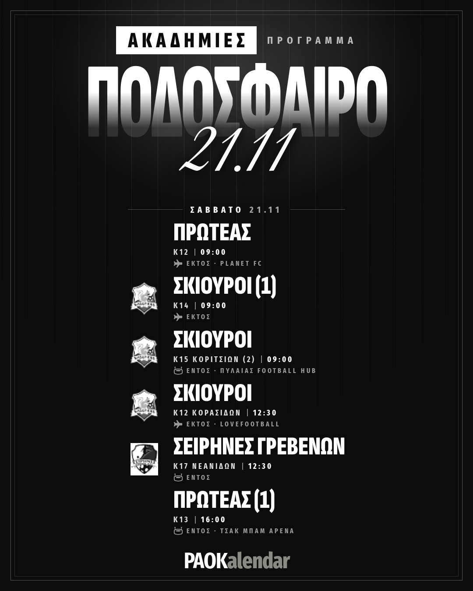</a> <a href="https://raw.githubusercontent.com/GabrielChatzi/PAOK-calendar/social/img/akadimies-2026-11-21-football-2-post.png">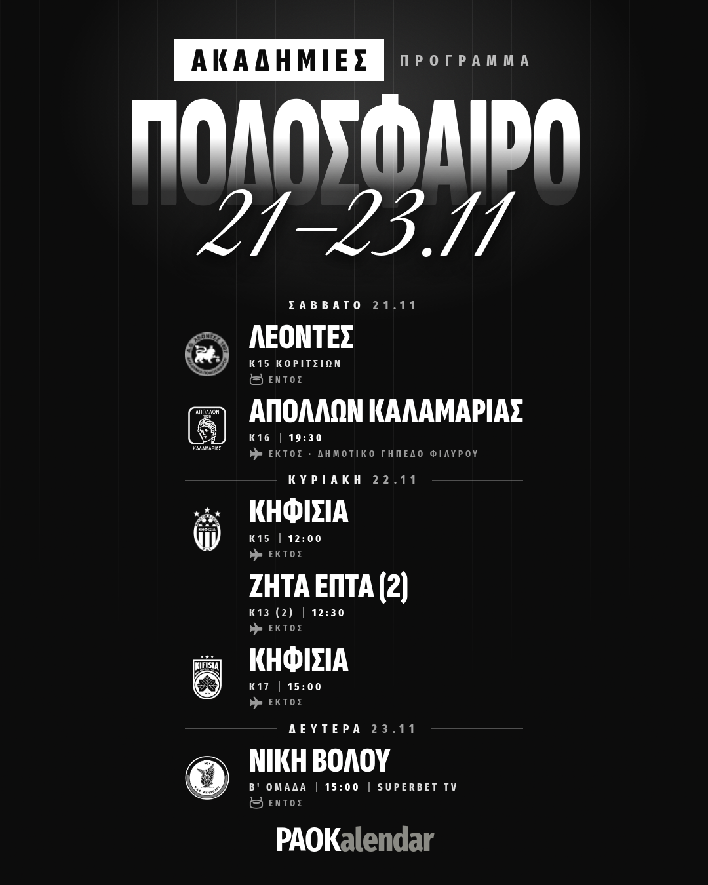</a> <a href="https://raw.githubusercontent.com/GabrielChatzi/PAOK-calendar/social/img/akadimies-2026-11-21-basketball-post.png">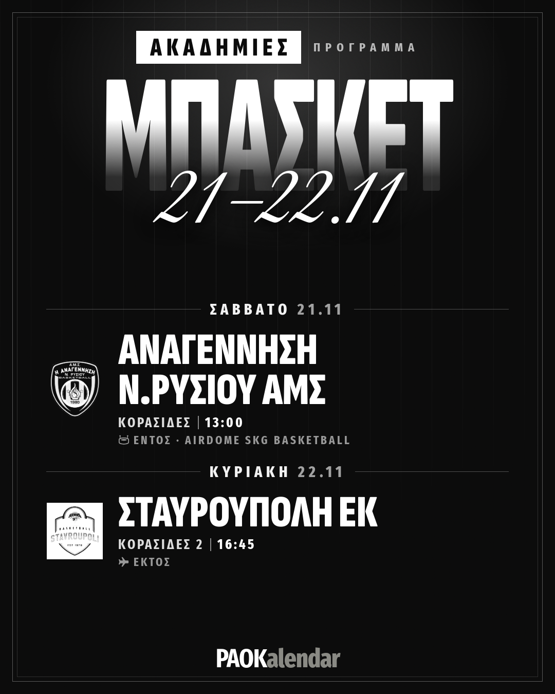</a> <a href="https://raw.githubusercontent.com/GabrielChatzi/PAOK-calendar/social/img/akadimies-2026-11-21-volley-post.png">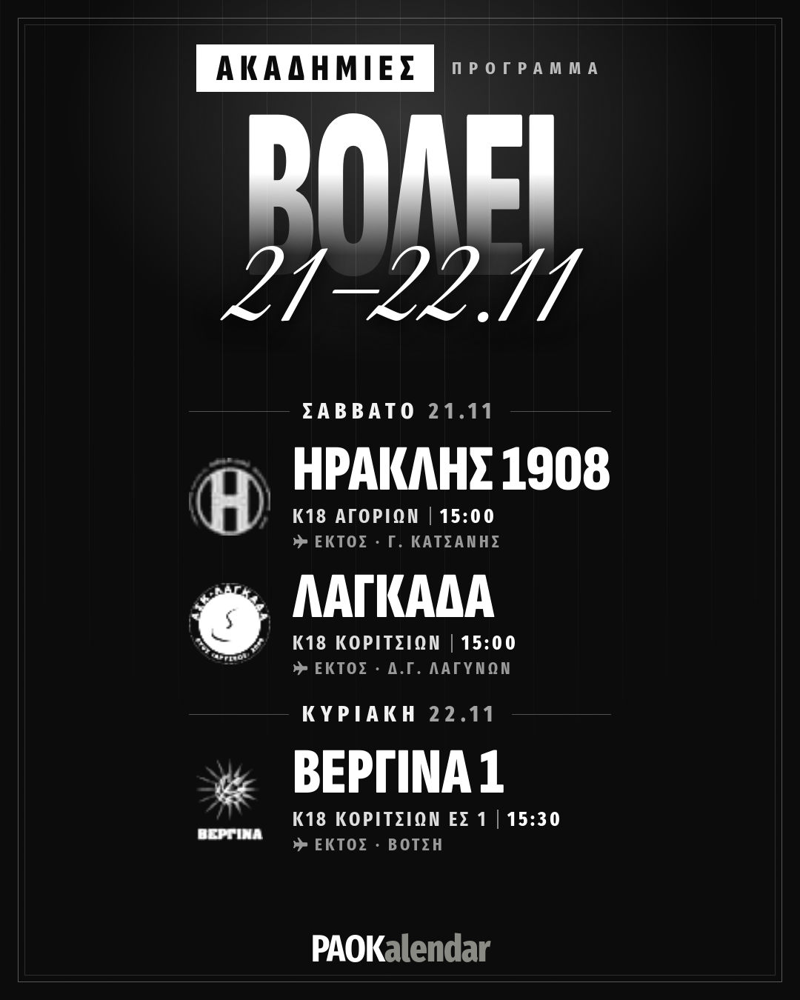</a>

```
Το Σαββατοκύριακο του ΠΑΟΚ σε όλα τα τμήματα ⚪️⚫️
9 αγώνες σε 5 αθλήματα, από Σάββατο ως Δευτέρα, με το ΠΑΟΚ–Κηφισιά την Κυριακή στις 19:30.
Στο carousel και οι 17 αγώνες των ακαδημιών 👶⚪️⚫️

Ώρες, κανάλια και ειδοποιήσεις για κάθε αγώνα: paokalendar.gr (link στο bio)

#ΠΑΟΚ #PAOK #PAOKalendar
```

## Σάββατο 21.11 (σήμερα)

### 09:00 · ⭕ Story: Σήμερα παίζει

Sticker «Σύνδεσμος» → paokalendar.gr

<a href="https://raw.githubusercontent.com/GabrielChatzi/PAOK-calendar/social/img/2026-11-21-story.png">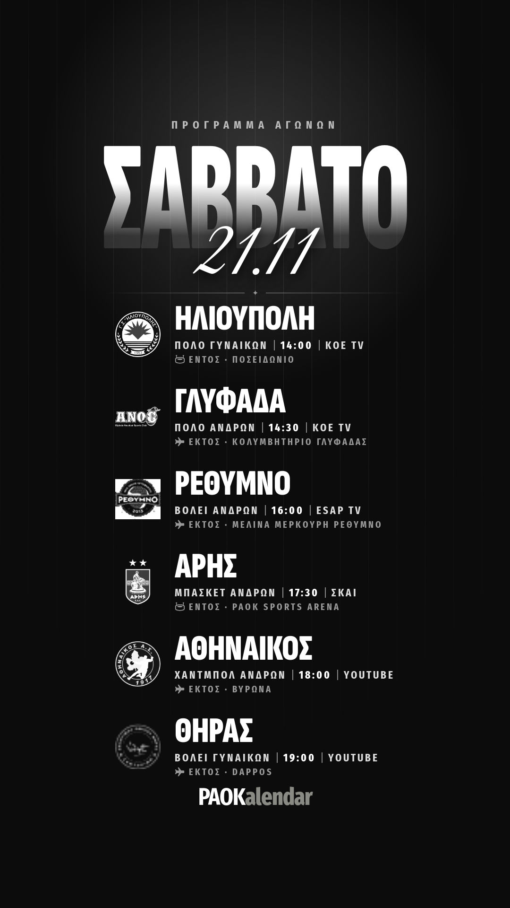</a>

### 15:21 · ⭕ Story: Αλλαγή προγράμματος

Άλλαξε: Πόλο Γυναικών: ΠΑΟΚ – Ηλιούπολη, Σάβ 21.11 14:00, Ποσειδώνιο · Άλλαξε: Πόλο Ανδρών: Γλυφάδα – ΠΑΟΚ, Σάβ 21.11 14:30, Κολυμβητήριο Γλυφάδας · Άλλαξε: Χάντμπολ Ανδρών: ΑΘΗΝΑΙΚΟΣ – ΠΑΟΚ, Σάβ 21.11 18:00, Βύρωνα · Sticker «Σύνδεσμος» → paokalendar.gr. Αν θέλεις, πρόσθεσε και στο post τη νέα εικόνα (επεξεργασία carousel).

<a href="https://raw.githubusercontent.com/GabrielChatzi/PAOK-calendar/social/img/allagi-e194c3cf-2026-11-21-story.png">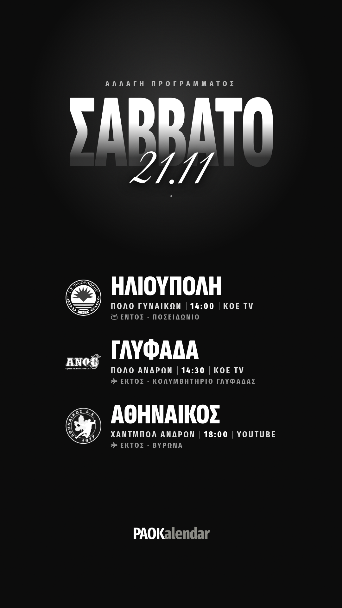</a>

### 21:30 · ⭕ Story: Αποτελέσματα ημέρας

Λείπει ακόμα το σκορ: ΑΘΗΝΑΙΚΟΣ Α.Σ.Β. – ΠΑΟΚ, Α.Ο. Θήρας – ΠΑΟΚ. Θα μπει μόλις έρθει.

<a href="https://raw.githubusercontent.com/GabrielChatzi/PAOK-calendar/social/img/2026-11-21-apotelesmata-story.png">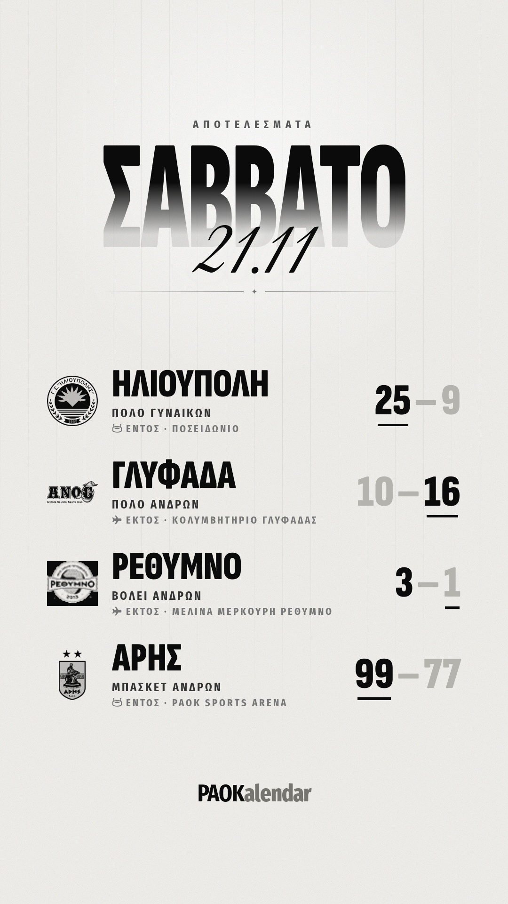</a>

## Κυριακή 22.11

### 09:00 · ⭕ Story: Σήμερα παίζει

Sticker «Σύνδεσμος» → paokalendar.gr

<a href="https://raw.githubusercontent.com/GabrielChatzi/PAOK-calendar/social/img/2026-11-22-story.png">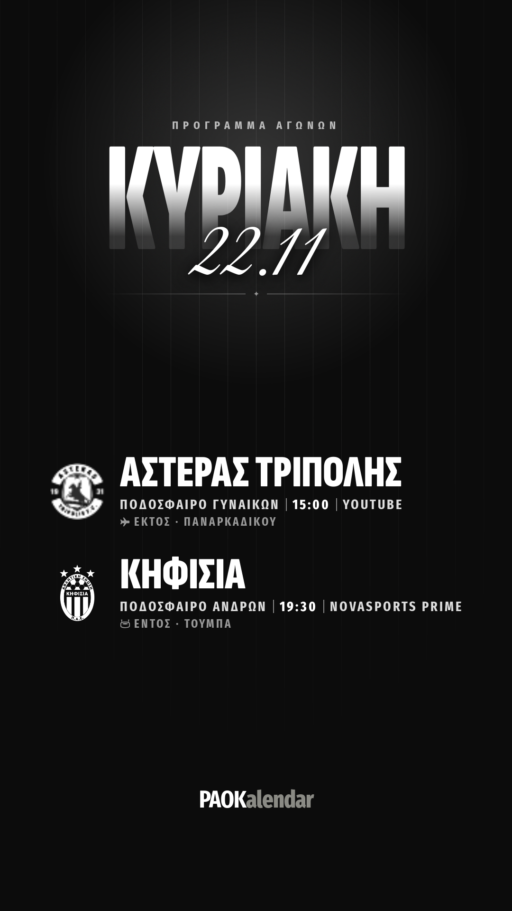</a>

### 22:00 · ⭕ Story: Αποτελέσματα ημέρας

Οι εικόνες θα βγουν μόλις έρθουν τα σκορ.

## Δευτέρα 23.11

### 09:00 · ⭕ Story: Σήμερα παίζει

Sticker «Σύνδεσμος» → paokalendar.gr

<a href="https://raw.githubusercontent.com/GabrielChatzi/PAOK-calendar/social/img/2026-11-23-story.png">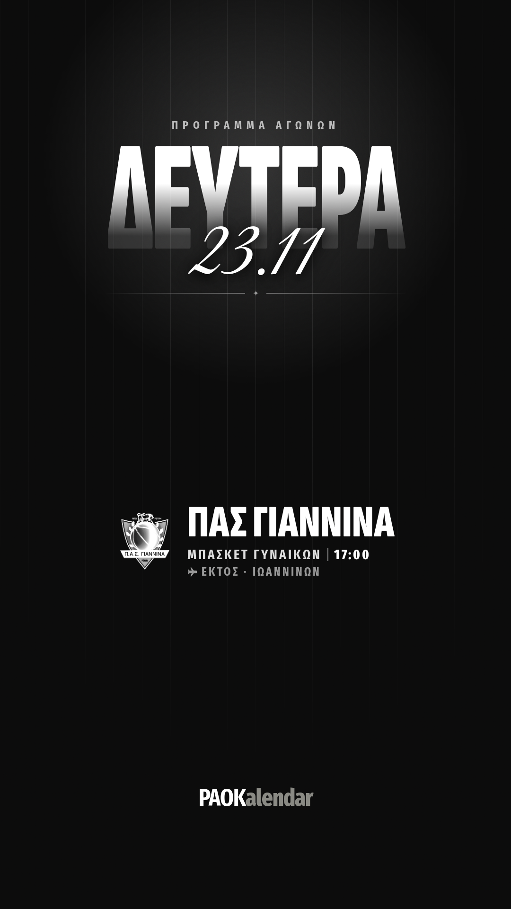</a>

### 19:30 · 📸 Post ⬜: Αποτελέσματα του Σαββατοκύριακου

Ακαδημίες χωρίς σκορ ακόμα: 10

Λείπει ακόμα το σκορ: ΑΘΗΝΑΙΚΟΣ Α.Σ.Β. – ΠΑΟΚ, Α.Ο. Θήρας – ΠΑΟΚ, ΑΣΤΕΡΑΣ ΤΡΙΠΟΛΗΣ – ΠΑΟΚ, ΠΑΟΚ – Κηφισιά, ΠΑΣ ΓΙΑΝΝΙΝΑ – ΠΑΟΚ. Θα μπει μόλις έρθει.

<a href="https://raw.githubusercontent.com/GabrielChatzi/PAOK-calendar/social/img/2026-11-21-apotelesmata-post.png">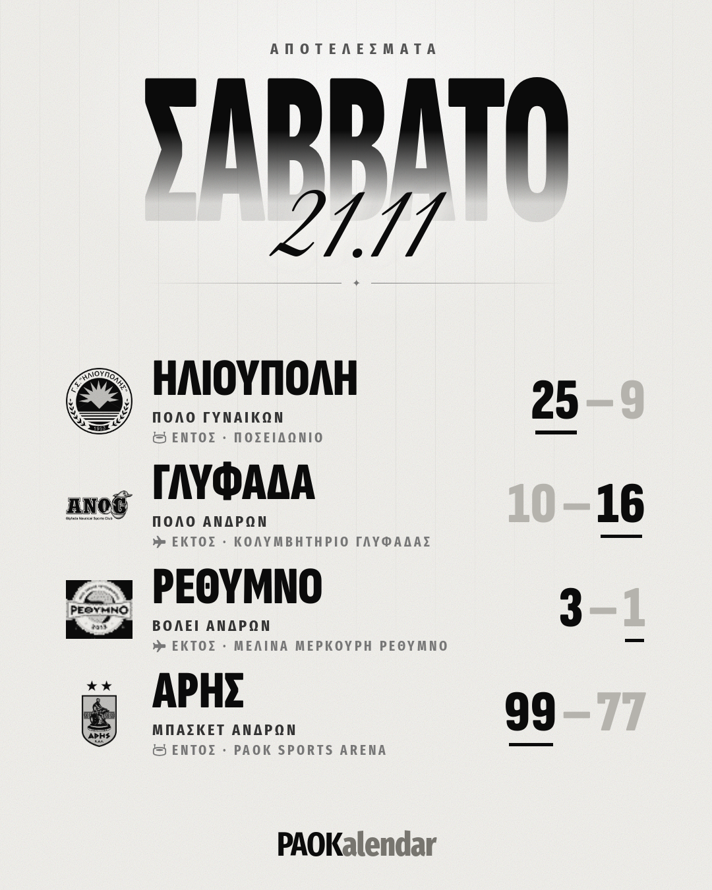</a> <a href="https://raw.githubusercontent.com/GabrielChatzi/PAOK-calendar/social/img/akadimies-2026-11-21-football-apotelesmata-post.png">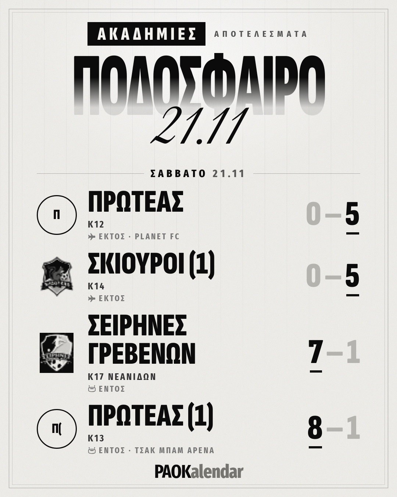</a> <a href="https://raw.githubusercontent.com/GabrielChatzi/PAOK-calendar/social/img/akadimies-2026-11-21-basketball-apotelesmata-post.png">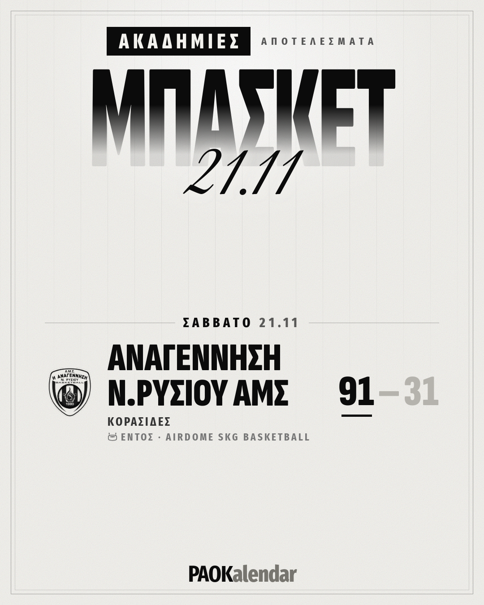</a> <a href="https://raw.githubusercontent.com/GabrielChatzi/PAOK-calendar/social/img/akadimies-2026-11-21-volley-apotelesmata-post.png">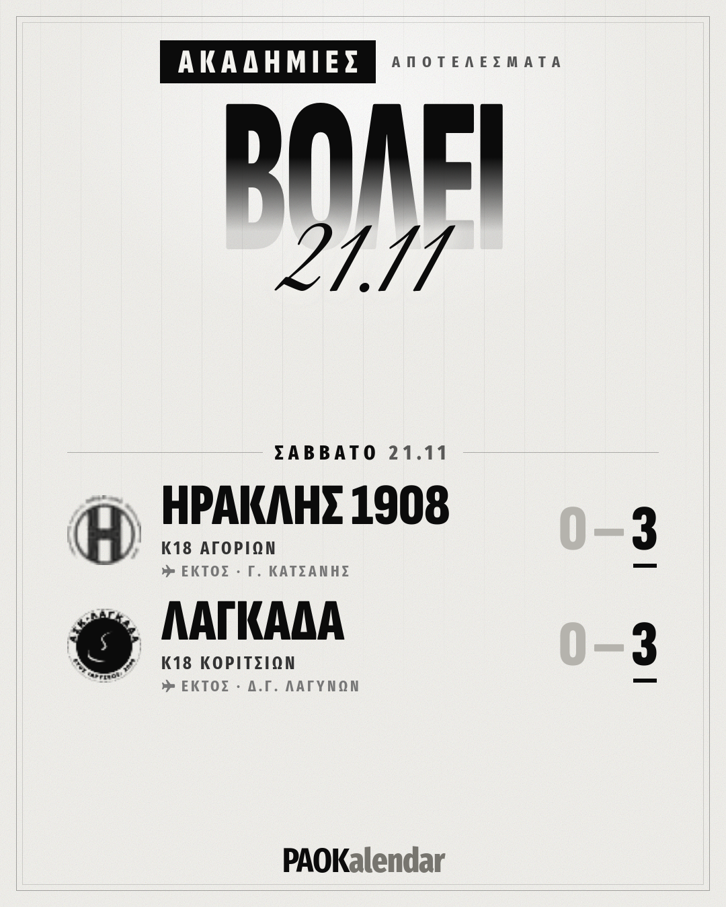</a>

```
Τα αποτελέσματα του Σαββατοκύριακου ⚪️⚫️
3 νίκες, 1 ήττα σε 4 αγώνες.
Στο carousel και τα αποτελέσματα των ακαδημιών 👏

Όλα τα σκορ και οι βαθμολογίες: paokalendar.gr (link στο bio)

#ΠΑΟΚ #PAOK #PAOKalendar
```

### 19:30 · ⭕ Story: Αποτελέσματα ημέρας

Οι εικόνες θα βγουν μόλις έρθουν τα σκορ.

### 20:00 · 📸 Post ⬛: Πρόγραμμα της εβδομάδας

<a href="https://raw.githubusercontent.com/GabrielChatzi/PAOK-calendar/social/img/2026-11-24_2026-11-27-post.png">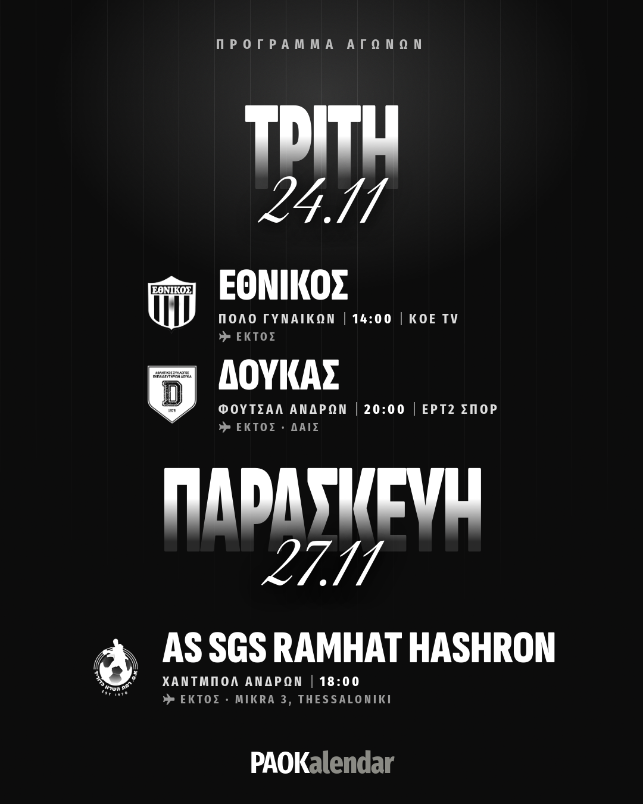</a>

```
Η εβδομάδα του ΠΑΟΚ σε όλα τα τμήματα ⚪️⚫️
3 αγώνες σε 3 αθλήματα, από Τρίτη ως Παρασκευή.

Ώρες, κανάλια και ειδοποιήσεις για κάθε αγώνα: paokalendar.gr (link στο bio)

#ΠΑΟΚ #PAOK #PAOKalendar
```

## Τρίτη 24.11

### 09:00 · ⭕ Story: Σήμερα παίζει

Sticker «Σύνδεσμος» → paokalendar.gr

<a href="https://raw.githubusercontent.com/GabrielChatzi/PAOK-calendar/social/img/2026-11-24-story.png">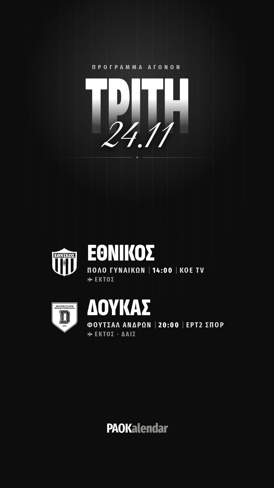</a>

### 22:00 · ⭕ Story: Αποτελέσματα ημέρας

Οι εικόνες θα βγουν μόλις έρθουν τα σκορ.

## Τετάρτη 25.11

### 20:00 · 🎬 Reel: Βαθμολογίες όλων των τμημάτων

Εγγραφή οθόνης: μενού → ένα ερασιτεχνικό τμήμα → «Βαθμολογία», 2–3 τμήματα στη σειρά.

```
Πού βρίσκεται ο ΠΑΟΚ σε κάθε άθλημα; 📊
Βαθμολογίες για όλα τα τμήματα, ανδρών και γυναικών, σε μία εφαρμογή.

Δωρεάν στο paokalendar.gr (link στο bio)

#ΠΑΟΚ #PAOK #PAOKalendar
```

## Παρασκευή 27.11

### 09:00 · ⭕ Story: Σήμερα παίζει

Sticker «Σύνδεσμος» → paokalendar.gr

<a href="https://raw.githubusercontent.com/GabrielChatzi/PAOK-calendar/social/img/2026-11-27-story.png"></a>

### 20:00 · 📸 Post ⬛: Πρόγραμμα του Σαββατοκύριακου

⚠️ Δύο ίδια χρώματα στη σειρά στο grid

<a href="https://raw.githubusercontent.com/GabrielChatzi/PAOK-calendar/social/img/2026-11-28-post.png">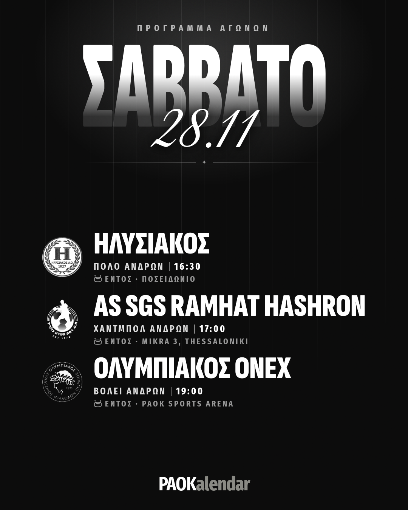</a> <a href="https://raw.githubusercontent.com/GabrielChatzi/PAOK-calendar/social/img/2026-11-29-post.png">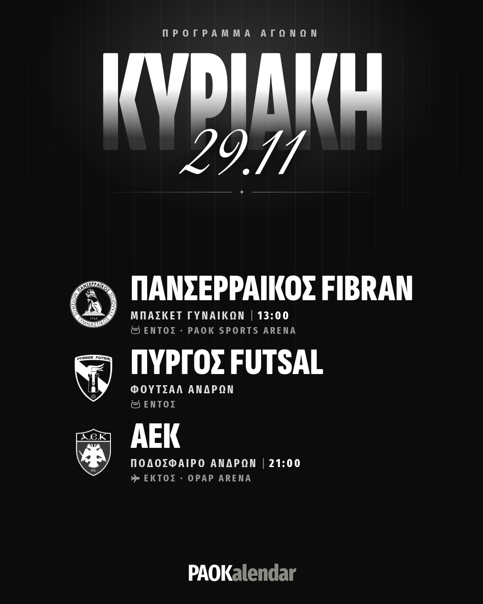</a> <a href="https://raw.githubusercontent.com/GabrielChatzi/PAOK-calendar/social/img/akadimies-2026-11-28-football-1-post.png">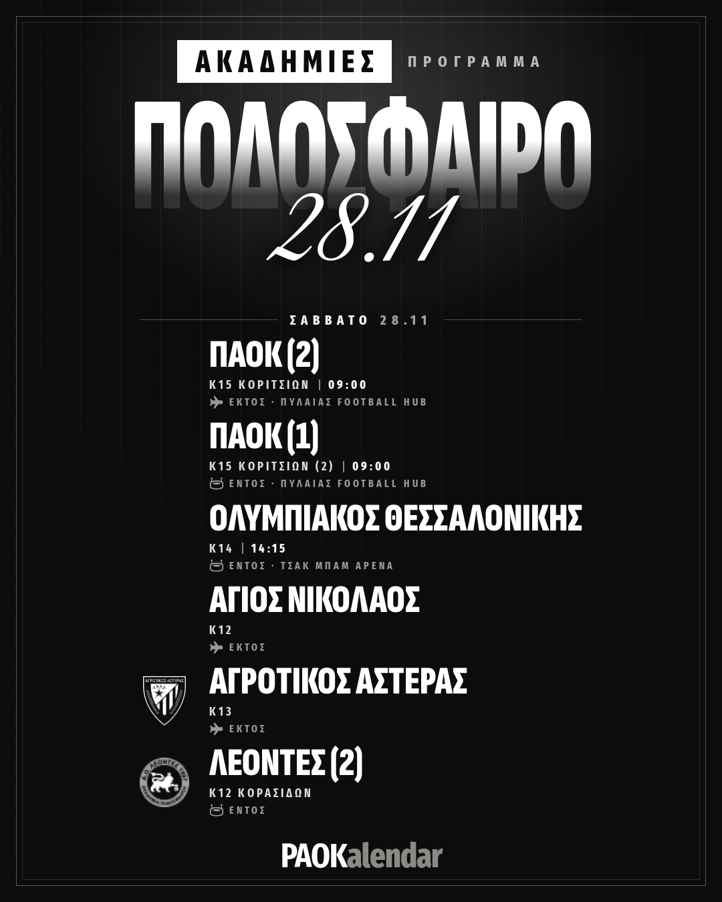</a> <a href="https://raw.githubusercontent.com/GabrielChatzi/PAOK-calendar/social/img/akadimies-2026-11-28-football-2-post.png">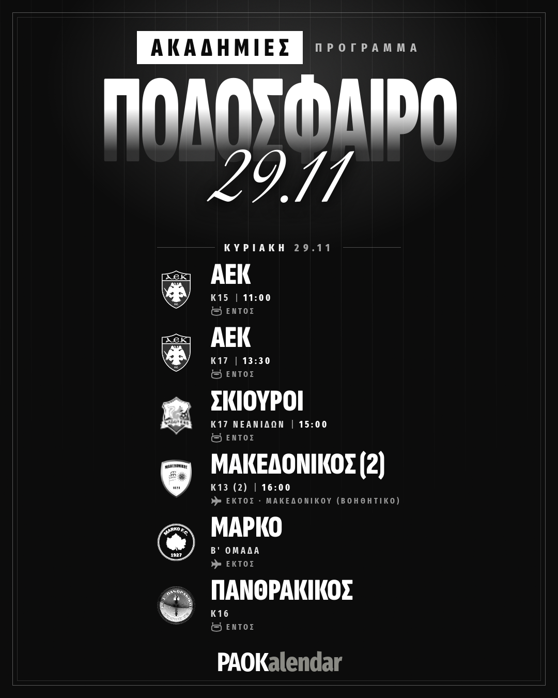</a> <a href="https://raw.githubusercontent.com/GabrielChatzi/PAOK-calendar/social/img/akadimies-2026-11-28-basketball-post.png">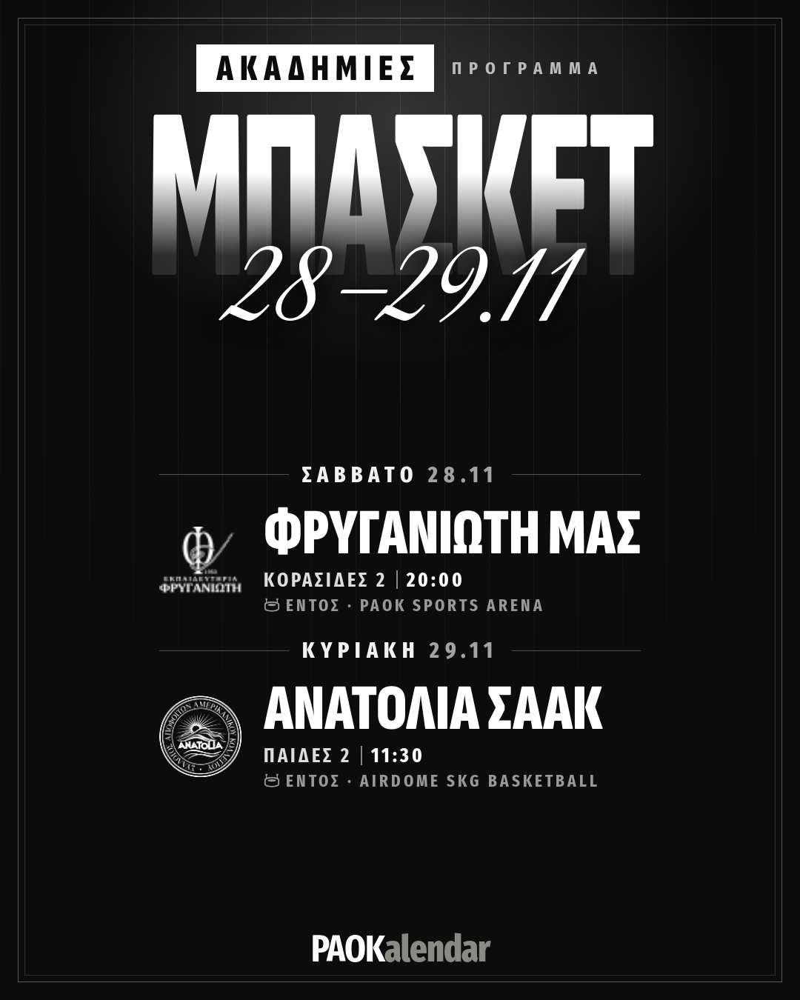</a> <a href="https://raw.githubusercontent.com/GabrielChatzi/PAOK-calendar/social/img/akadimies-2026-11-28-volley-post.png">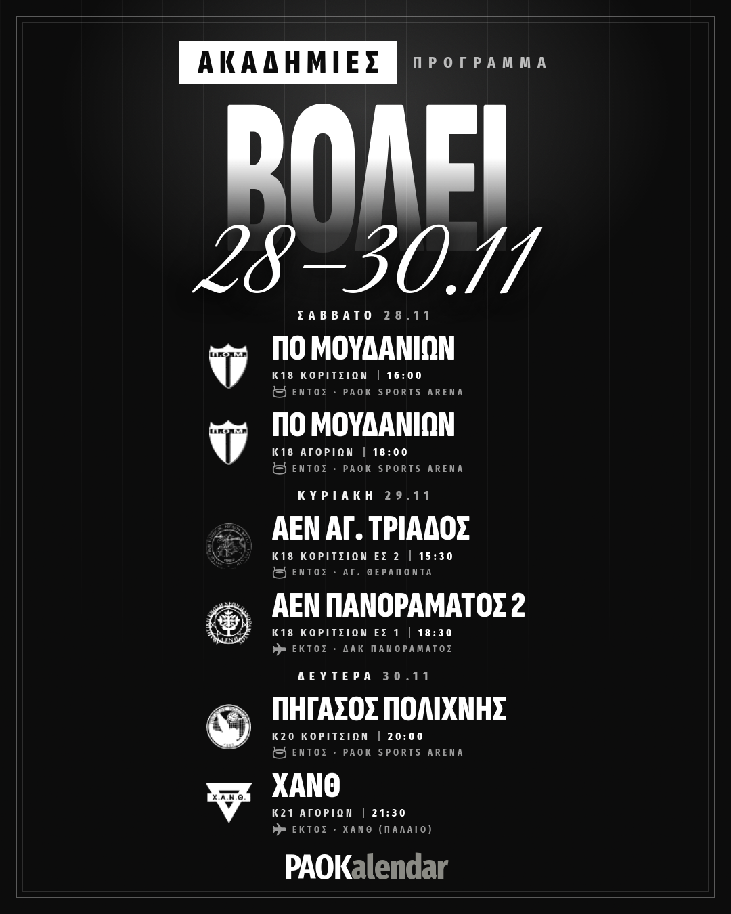</a>

```
Το Σαββατοκύριακο του ΠΑΟΚ σε όλα τα τμήματα ⚪️⚫️
6 αγώνες σε 6 αθλήματα, από Σάββατο ως Κυριακή, με το ΑΕΚ–ΠΑΟΚ την Κυριακή στις 21:00.
Στο carousel και οι 20 αγώνες των ακαδημιών 👶⚪️⚫️

Ώρες, κανάλια και ειδοποιήσεις για κάθε αγώνα: paokalendar.gr (link στο bio)

#ΠΑΟΚ #PAOK #PAOKalendar
```

### 20:00 · ⭕ Story: Αποτελέσματα ημέρας

Οι εικόνες θα βγουν μόλις έρθουν τα σκορ.
