# Social: 07.11 – 13.11

Φτιάχνεται μόνο του μετά από κάθε ενημέρωση του προγράμματος (social.yml), οπότε δείχνει πάντα τις τελευταίες ώρες και αλλαγές. Στο iPhone (Safari): πάτα μια εικόνα, κράτα το δάχτυλο πάνω της → «Προσθήκη στις Φωτογραφίες».

## Σάββατο 07.11 (σήμερα)

### 09:00 · ⭕ Story: Σήμερα παίζει

Sticker «Σύνδεσμος» → paokalendar.gr

<a href="https://raw.githubusercontent.com/GabrielChatzi/PAOK-calendar/social/img/2026-11-07-story.png">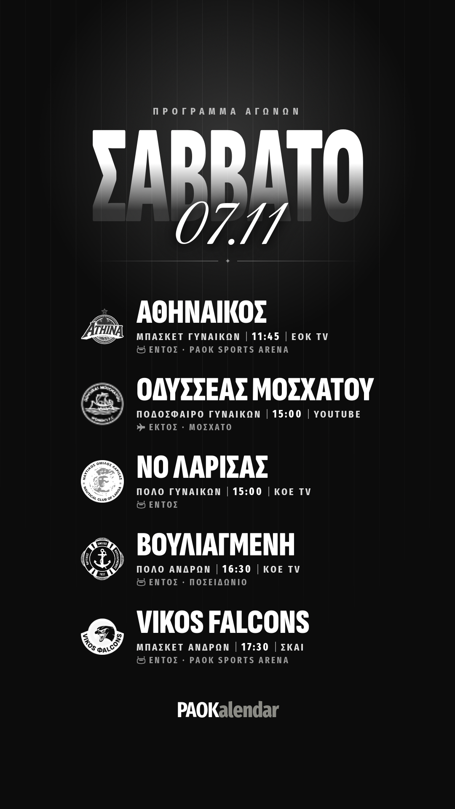</a>

### 20:00 · ⭕ Story: Αποτελέσματα ημέρας

Λείπει ακόμα το σκορ: ΠΑΟΚ – Vikos Falcons. Θα μπει μόλις έρθει.

<a href="https://raw.githubusercontent.com/GabrielChatzi/PAOK-calendar/social/img/2026-11-07-apotelesmata-story.png">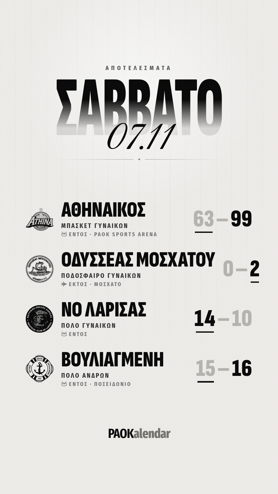</a>

## Κυριακή 08.11

### 09:00 · ⭕ Story: Σήμερα παίζει

Sticker «Σύνδεσμος» → paokalendar.gr

<a href="https://raw.githubusercontent.com/GabrielChatzi/PAOK-calendar/social/img/2026-11-08-story.png">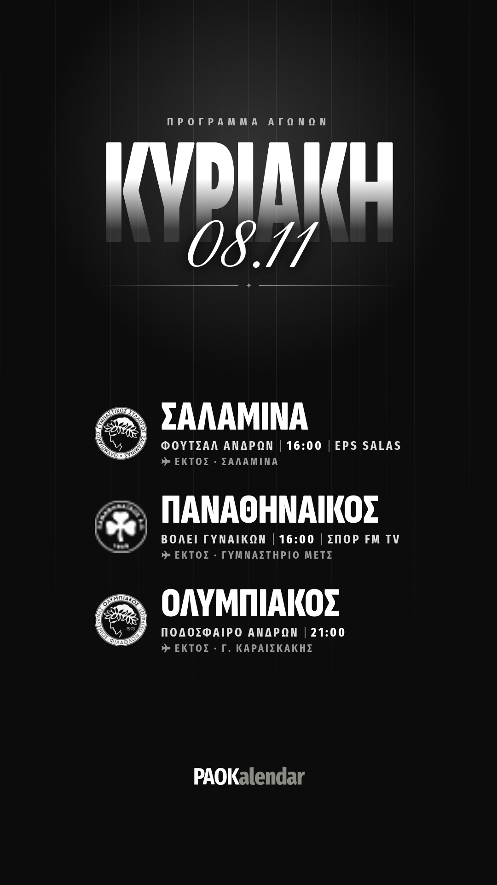</a>

### 23:30 · ⭕ Story: Αποτελέσματα ημέρας

Οι εικόνες θα βγουν μόλις έρθουν τα σκορ.

## Δευτέρα 09.11

### 09:00 · ⭕ Story: Σήμερα παίζει

Sticker «Σύνδεσμος» → paokalendar.gr

<a href="https://raw.githubusercontent.com/GabrielChatzi/PAOK-calendar/social/img/2026-11-09-story.png">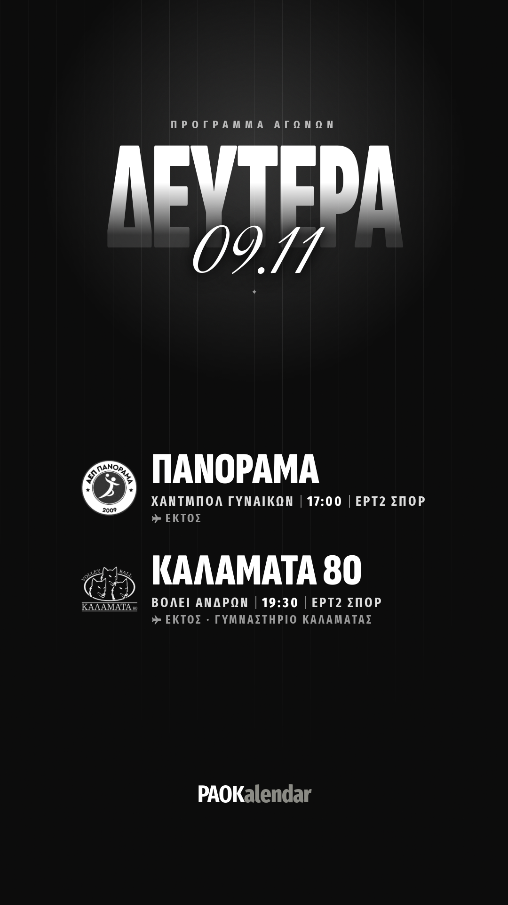</a>

### 22:00 · 📸 Post: Πρόγραμμα της εβδομάδας

<a href="https://raw.githubusercontent.com/GabrielChatzi/PAOK-calendar/social/img/2026-11-10-post.png">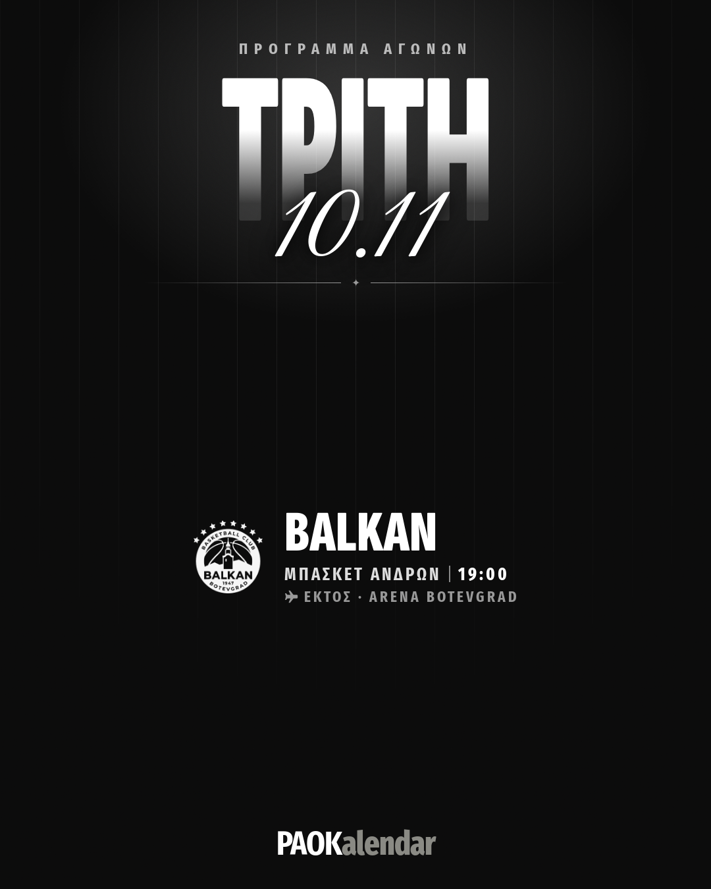</a> <a href="https://raw.githubusercontent.com/GabrielChatzi/PAOK-calendar/social/img/2026-11-13-post.png">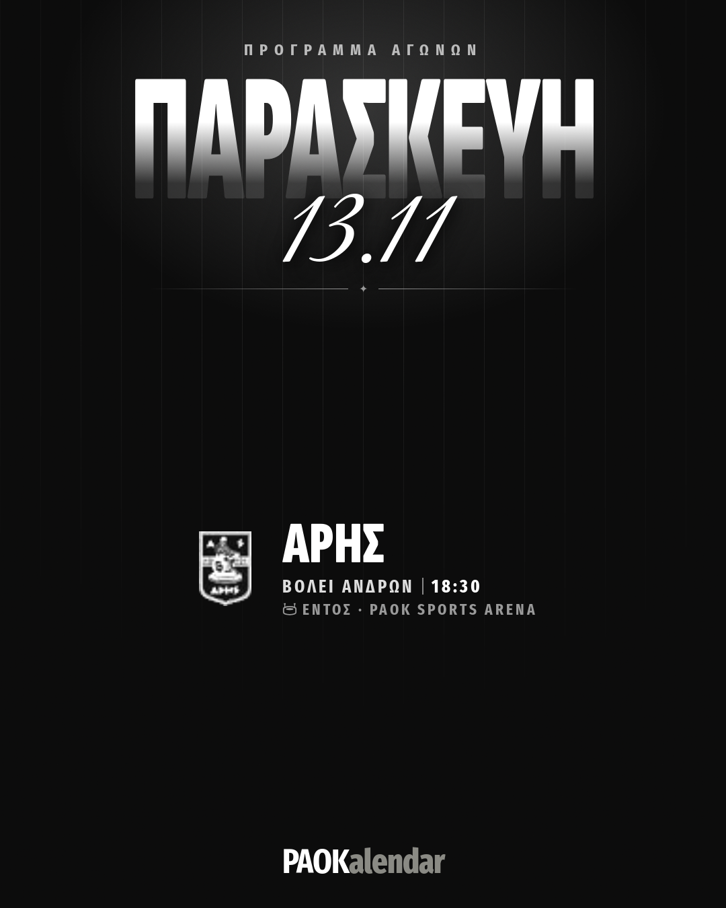</a>

```
Η εβδομάδα του ΠΑΟΚ σε όλα τα τμήματα 🖤🤍
2 αγώνες σε 2 αθλήματα, από Τρίτη ως Παρασκευή, με το Balkan–ΠΑΟΚ την Τρίτη στις 19:00.

Ώρες, κανάλια και ειδοποιήσεις για κάθε αγώνα: paokalendar.gr (link στο bio)

#ΠΑΟΚ #PAOK #PAOKalendar
```

### 22:00 · ⭕ Story: Αποτελέσματα ημέρας

Οι εικόνες θα βγουν μόλις έρθουν τα σκορ.

## Τρίτη 10.11

### 09:00 · 📸 Post: Αποτελέσματα του Σαββατοκύριακου

Λείπει ακόμα το σκορ: ΠΑΟΚ – Vikos Falcons, ΣΑΛΑΜΙΝΑ ΓΣ – ΠΑΟΚ, PANATHINAIKOS A.O. – ΠΑΟΚ, Ολυμπιακός – ΠΑΟΚ, Α.Ε.Π. ΠΑΝΟΡΑΜΑ – ΠΑΟΚ, Α.Ο.Καλαμάτα 80 Affidea – ΠΑΟΚ. Θα μπει μόλις έρθει.

<a href="https://raw.githubusercontent.com/GabrielChatzi/PAOK-calendar/social/img/2026-11-07-apotelesmata-post.png">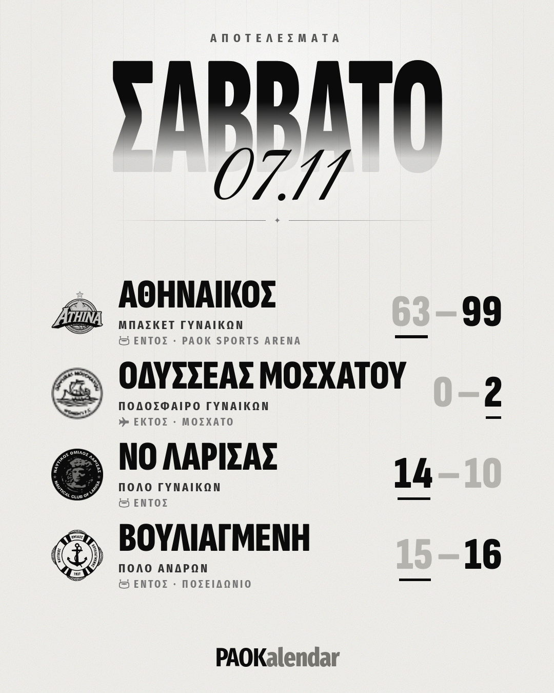</a>

```
Τα αποτελέσματα του Σαββατοκύριακου 🖤🤍
2 νίκες, 2 ήττες σε 4 αγώνες.

Όλα τα σκορ και οι βαθμολογίες: paokalendar.gr (link στο bio)

#ΠΑΟΚ #PAOK #PAOKalendar
```

### 09:00 · ⭕ Story: Σήμερα παίζει

Sticker «Σύνδεσμος» → paokalendar.gr

<a href="https://raw.githubusercontent.com/GabrielChatzi/PAOK-calendar/social/img/2026-11-10-story.png">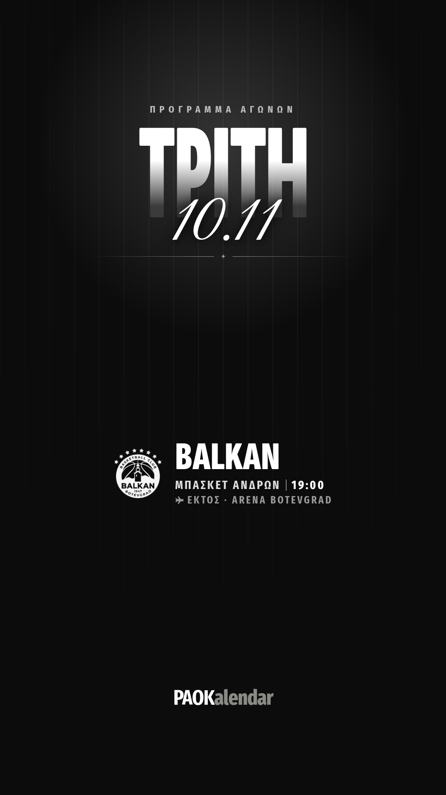</a>

### 21:30 · ⭕ Story: Αποτελέσματα ημέρας

Οι εικόνες θα βγουν μόλις έρθουν τα σκορ.

## Τετάρτη 11.11

### 20:00 · 🎬 Reel: Πώς βάζεις ειδοποίηση για έναν αγώνα

Εγγραφή οθόνης: άνοιγμα εφαρμογής → αγώνας → «Ειδοποιήσεις» → «1 ώρα πριν» και «Live».

```
Μάθε για κάθε γκολ πριν το δεις στην τηλεόραση ⚽🔔
Σε 10'' από το κινητό σου, χωρίς λογαριασμό.

Δωρεάν στο paokalendar.gr (link στο bio)

#ΠΑΟΚ #PAOK #PAOKalendar
```

## Παρασκευή 13.11

### 09:00 · ⭕ Story: Σήμερα παίζει

Sticker «Σύνδεσμος» → paokalendar.gr

<a href="https://raw.githubusercontent.com/GabrielChatzi/PAOK-calendar/social/img/2026-11-13-story.png">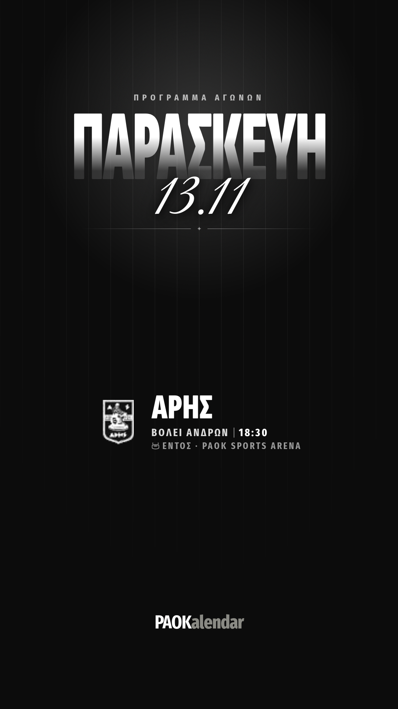</a>

### 21:00 · 📸 Post: Πρόγραμμα του Σαββατοκύριακου

<a href="https://raw.githubusercontent.com/GabrielChatzi/PAOK-calendar/social/img/2026-11-14-post.png">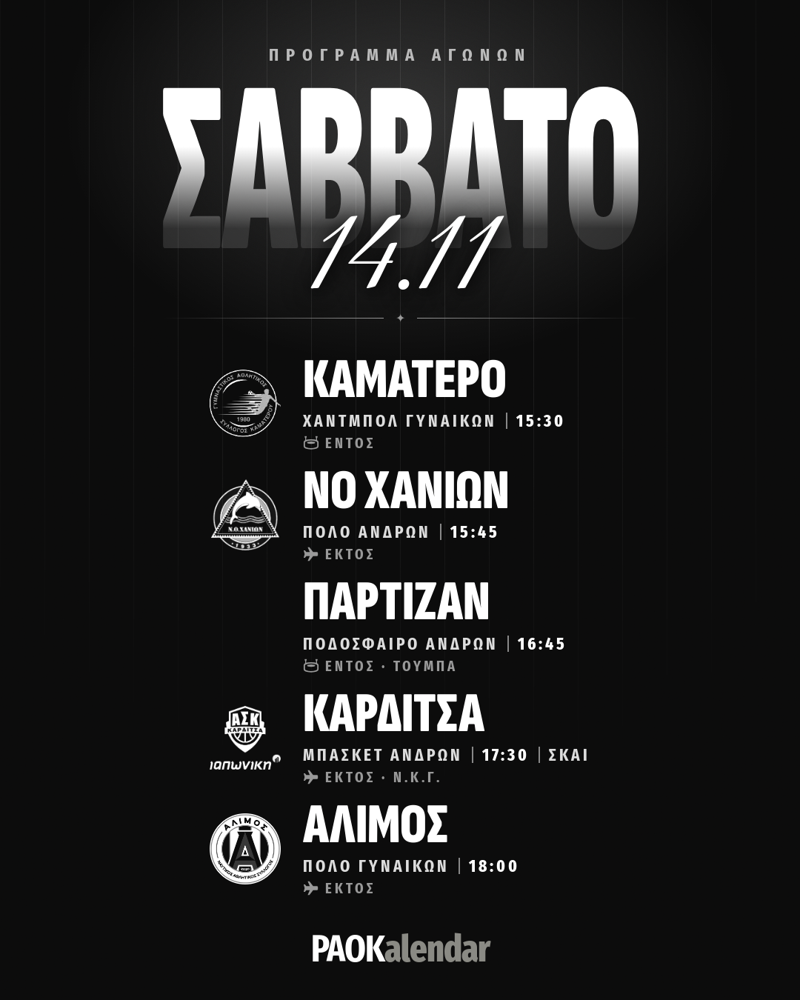</a> <a href="https://raw.githubusercontent.com/GabrielChatzi/PAOK-calendar/social/img/2026-11-15-post.png">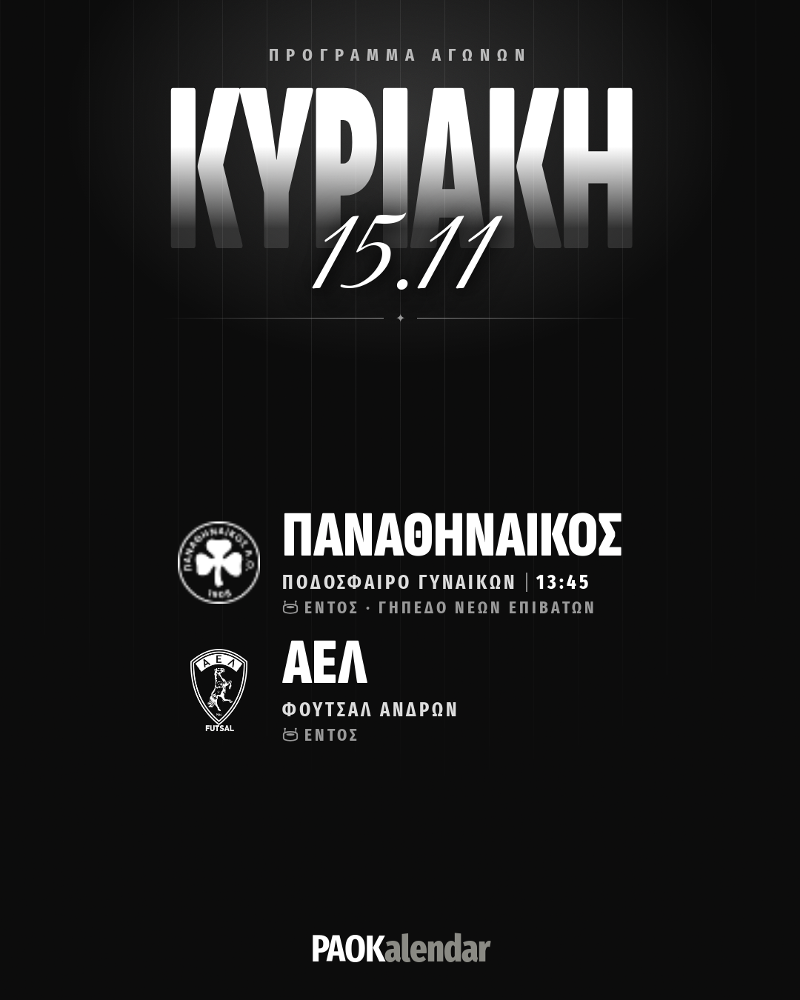</a> <a href="https://raw.githubusercontent.com/GabrielChatzi/PAOK-calendar/social/img/2026-11-16-post.png">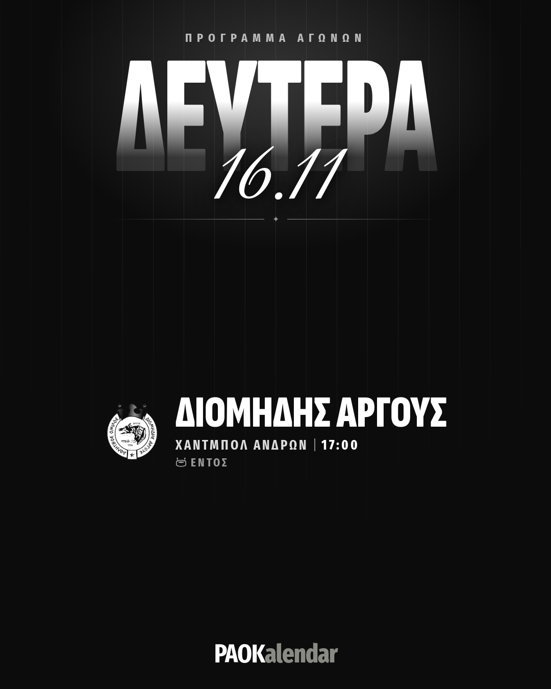</a>

```
Το Σαββατοκύριακο του ΠΑΟΚ σε όλα τα τμήματα 🖤🤍
8 αγώνες σε 5 αθλήματα, από Σάββατο ως Δευτέρα, με το ΠΑΟΚ–Παρτιζάν το Σάββατο στις 16:45.

Ώρες, κανάλια και ειδοποιήσεις για κάθε αγώνα: paokalendar.gr (link στο bio)

#ΠΑΟΚ #PAOK #PAOKalendar
```

### 21:00 · ⭕ Story: Αποτελέσματα ημέρας

Οι εικόνες θα βγουν μόλις έρθουν τα σκορ.
