# Social: 14.11 – 20.11

Φτιάχνεται μόνο του μετά από κάθε ενημέρωση του προγράμματος (social.yml), οπότε δείχνει πάντα τις τελευταίες ώρες και αλλαγές. Στο iPhone (Safari): πάτα μια εικόνα, κράτα το δάχτυλο πάνω της → «Προσθήκη στις Φωτογραφίες».

## Παρασκευή 13.11

### 09:00 · ⭕ Story: Σήμερα παίζει

Sticker «Σύνδεσμος» → paokalendar.gr

<a href="https://raw.githubusercontent.com/GabrielChatzi/PAOK-calendar/social/img/2026-11-13-story.png"></a>

### 21:00 · 📸 Post: Πρόγραμμα του Σαββατοκύριακου

<a href="https://raw.githubusercontent.com/GabrielChatzi/PAOK-calendar/social/img/2026-11-14-post.png"></a> <a href="https://raw.githubusercontent.com/GabrielChatzi/PAOK-calendar/social/img/2026-11-15-post.png"></a> <a href="https://raw.githubusercontent.com/GabrielChatzi/PAOK-calendar/social/img/2026-11-16-post.png"></a>

```
Το Σαββατοκύριακο του ΠΑΟΚ σε όλα τα τμήματα ⚪️⚫️
9 αγώνες σε 6 αθλήματα, από Σάββατο ως Δευτέρα, με το ΠΑΟΚ–Partizan Belgrade το Σάββατο στις 16:45.

Ώρες, κανάλια και ειδοποιήσεις για κάθε αγώνα: paokalendar.gr (link στο bio)

#ΠΑΟΚ #PAOK #PAOKalendar
```

### 21:00 · ⭕ Story: Αποτελέσματα ημέρας

<a href="https://raw.githubusercontent.com/GabrielChatzi/PAOK-calendar/social/img/2026-11-13-apotelesmata-story.png">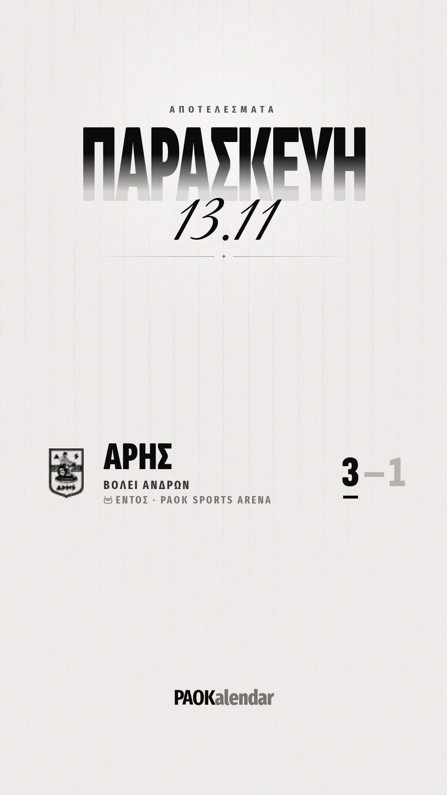</a>

## Σάββατο 14.11 (σήμερα)

### 09:00 · 📸 Post: Αποτελέσματα της εβδομάδας

<a href="https://raw.githubusercontent.com/GabrielChatzi/PAOK-calendar/social/img/2026-11-10_2026-11-13-apotelesmata-post.png">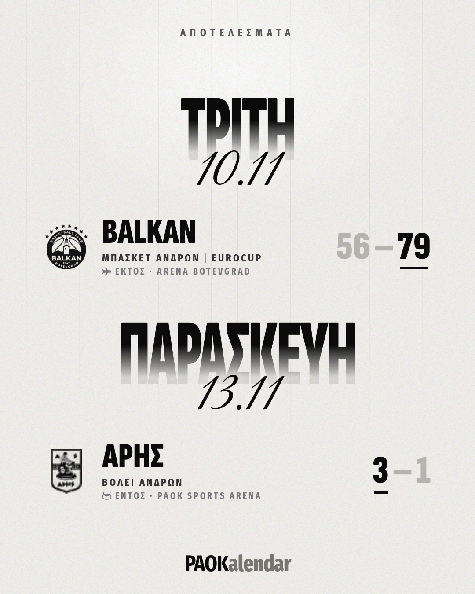</a>

```
Τα αποτελέσματα της εβδομάδας ⚪️⚫️
2 νίκες σε 2 αγώνες.

Όλα τα σκορ και οι βαθμολογίες: paokalendar.gr (link στο bio)

#ΠΑΟΚ #PAOK #PAOKalendar
```

### 09:00 · ⭕ Story: Σήμερα παίζει

Sticker «Σύνδεσμος» → paokalendar.gr

<a href="https://raw.githubusercontent.com/GabrielChatzi/PAOK-calendar/social/img/2026-11-14-story.png">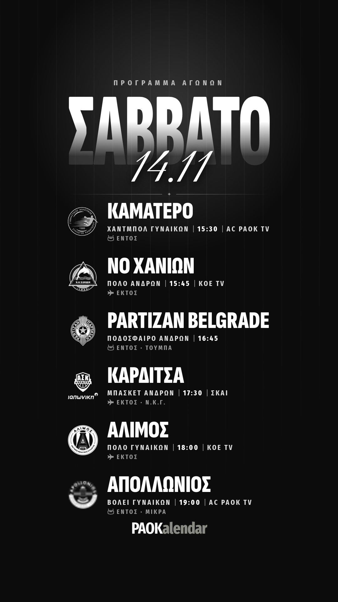</a>

### 21:30 · ⭕ Story: Αποτελέσματα ημέρας

Λείπει ακόμα το σκορ: ΠΑΟΚ – Γ.Α.Σ ΚΑΜΑΤΕΡΟΥ, ΠΑΟΚ – Partizan Belgrade, Καρδίτσα – ΠΑΟΚ, ΑΛΙΜΟΣ ΝΑΣ – ΠΑΟΚ, ΠΑΟΚ – Ο.Φ.Α. Απολλώνιος. Θα μπει μόλις έρθει.

<a href="https://raw.githubusercontent.com/GabrielChatzi/PAOK-calendar/social/img/2026-11-14-apotelesmata-story.png">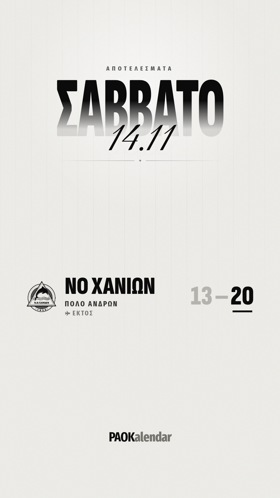</a>

## Κυριακή 15.11

### 09:00 · ⭕ Story: Σήμερα παίζει

Sticker «Σύνδεσμος» → paokalendar.gr

<a href="https://raw.githubusercontent.com/GabrielChatzi/PAOK-calendar/social/img/2026-11-15-story.png">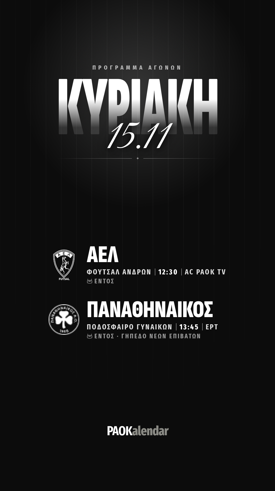</a>

### 16:00 · ⭕ Story: Αποτελέσματα ημέρας

Οι εικόνες θα βγουν μόλις έρθουν τα σκορ.

## Δευτέρα 16.11

### 09:00 · ⭕ Story: Σήμερα παίζει

Sticker «Σύνδεσμος» → paokalendar.gr

<a href="https://raw.githubusercontent.com/GabrielChatzi/PAOK-calendar/social/img/2026-11-16-story.png">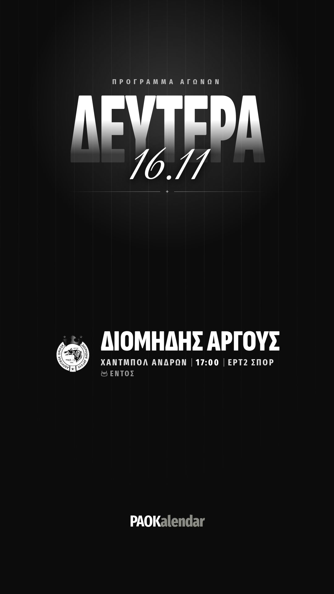</a>

### 19:00 · ⭕ Story: Αποτελέσματα ημέρας

Οι εικόνες θα βγουν μόλις έρθουν τα σκορ.

## Τρίτη 17.11

### 09:00 · 📸 Post: Αποτελέσματα του Σαββατοκύριακου

Λείπει ακόμα το σκορ: ΠΑΟΚ – Γ.Α.Σ ΚΑΜΑΤΕΡΟΥ, ΠΑΟΚ – Partizan Belgrade, Καρδίτσα – ΠΑΟΚ, ΑΛΙΜΟΣ ΝΑΣ – ΠΑΟΚ, ΠΑΟΚ – Ο.Φ.Α. Απολλώνιος, ΠΑΟΚ – ΑΕΛ, ΠΑΟΚ – ΠΑΝΑΘΗΝΑΪΚΟΣ ΑΟ, ΠΑΟΚ – ΔΙΟΜΗΔΗΣ ΑΡΓΟΥΣ. Θα μπει μόλις έρθει.

<a href="https://raw.githubusercontent.com/GabrielChatzi/PAOK-calendar/social/img/2026-11-14-apotelesmata-post.png">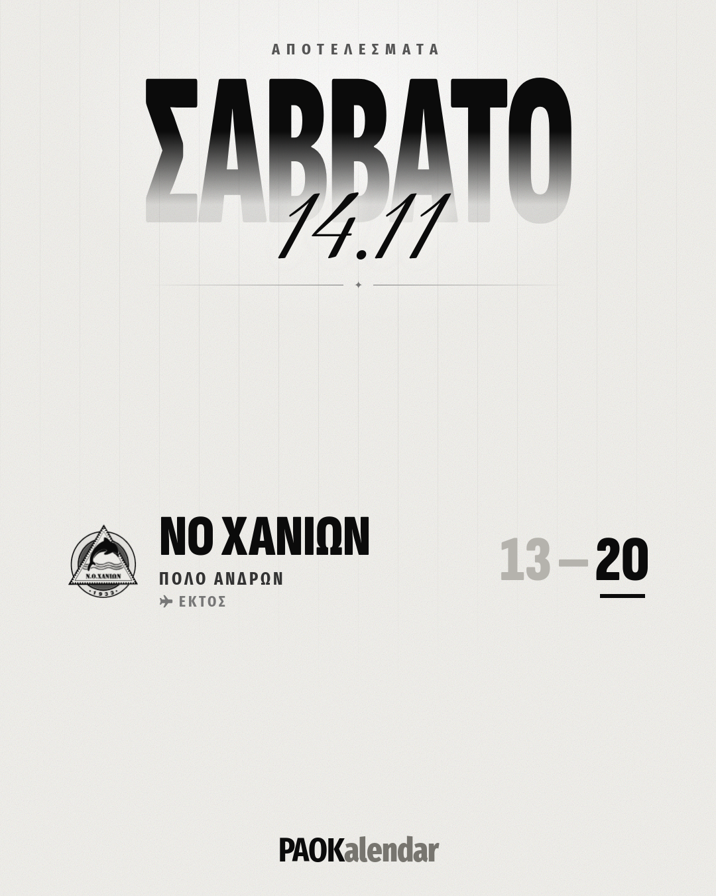</a>

```
Τα αποτελέσματα του Σαββατοκύριακου ⚪️⚫️
1 νίκη σε 1 αγώνα.

Όλα τα σκορ και οι βαθμολογίες: paokalendar.gr (link στο bio)

#ΠΑΟΚ #PAOK #PAOKalendar
```

### 19:00 · 📸 Post: Πρόγραμμα της εβδομάδας

<a href="https://raw.githubusercontent.com/GabrielChatzi/PAOK-calendar/social/img/2026-11-18_2026-11-20-post.png">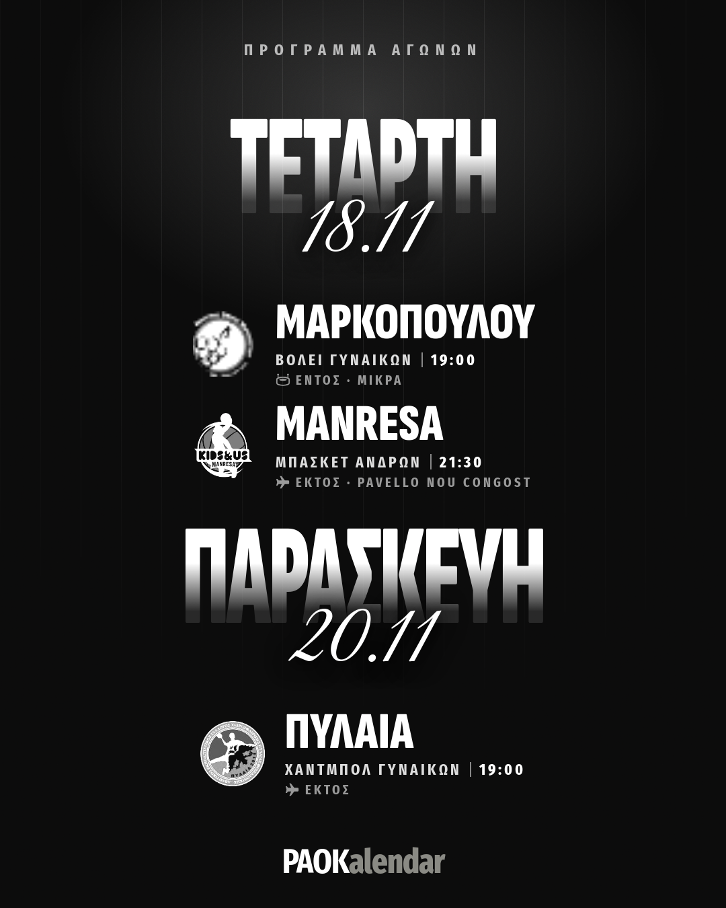</a>

```
Η εβδομάδα του ΠΑΟΚ σε όλα τα τμήματα ⚪️⚫️
3 αγώνες σε 3 αθλήματα, από Τετάρτη ως Παρασκευή, με το Manresa–ΠΑΟΚ την Τετάρτη στις 21:30.

Ώρες, κανάλια και ειδοποιήσεις για κάθε αγώνα: paokalendar.gr (link στο bio)

#ΠΑΟΚ #PAOK #PAOKalendar
```

## Τετάρτη 18.11

### 00:00 · ⭕ Story: Αποτελέσματα ημέρας

Οι εικόνες θα βγουν μόλις έρθουν τα σκορ.

### 09:00 · ⭕ Story: Σήμερα παίζει

Sticker «Σύνδεσμος» → paokalendar.gr

<a href="https://raw.githubusercontent.com/GabrielChatzi/PAOK-calendar/social/img/2026-11-18-story.png">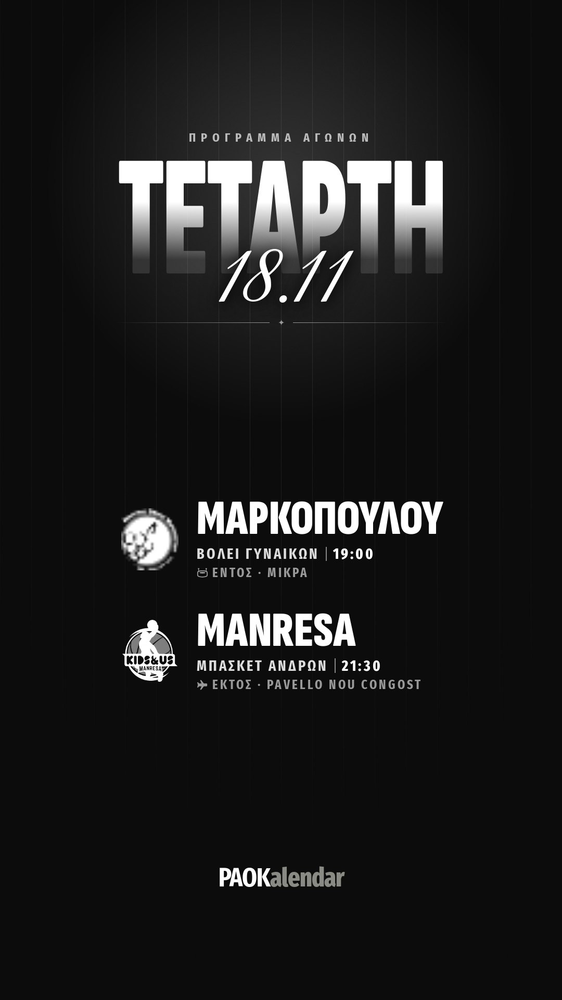</a>

## Πέμπτη 19.11

### 20:00 · 🎬 Reel: Όλα τα ματς στο ημερολόγιο του κινητού

Εγγραφή οθόνης: «Ημερολόγια» → ένα τμήμα → προσθήκη → οι αγώνες στο ημερολόγιο του κινητού.

```
Όλοι οι αγώνες του ΠΑΟΚ στο ημερολόγιο του κινητού σου 🗓️
Ενημερώνεται μόνο του όταν αλλάζει μια ώρα.

Δωρεάν στο paokalendar.gr (link στο bio)

#ΠΑΟΚ #PAOK #PAOKalendar
```

## Παρασκευή 20.11

### 09:00 · ⭕ Story: Σήμερα παίζει

Sticker «Σύνδεσμος» → paokalendar.gr

<a href="https://raw.githubusercontent.com/GabrielChatzi/PAOK-calendar/social/img/2026-11-20-story.png">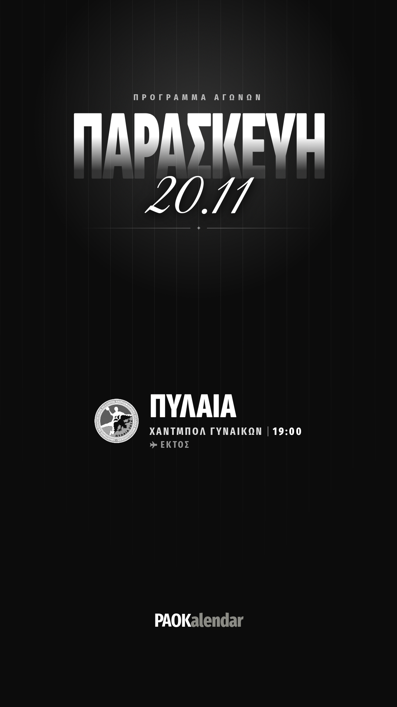</a>

### 21:00 · 📸 Post: Πρόγραμμα του Σαββατοκύριακου

<a href="https://raw.githubusercontent.com/GabrielChatzi/PAOK-calendar/social/img/2026-11-21-post.png">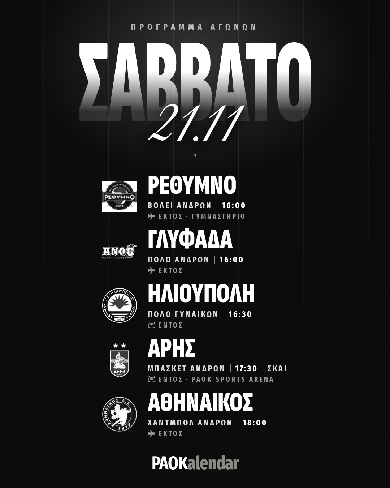</a> <a href="https://raw.githubusercontent.com/GabrielChatzi/PAOK-calendar/social/img/2026-11-22-post.png">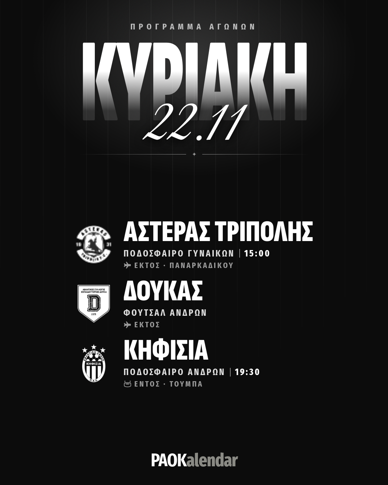</a> <a href="https://raw.githubusercontent.com/GabrielChatzi/PAOK-calendar/social/img/2026-11-23-post.png">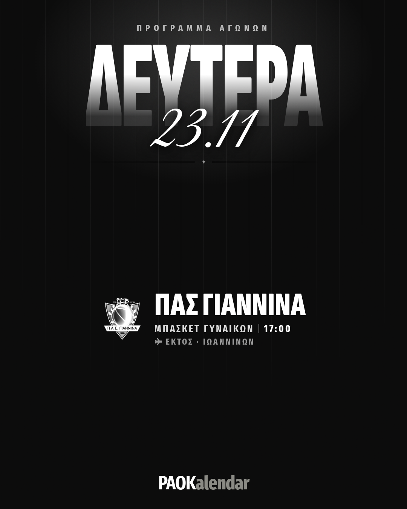</a>

```
Το Σαββατοκύριακο του ΠΑΟΚ σε όλα τα τμήματα ⚪️⚫️
9 αγώνες σε 6 αθλήματα, από Σάββατο ως Δευτέρα, με το ΠΑΟΚ–Κηφισιά την Κυριακή στις 19:30.

Ώρες, κανάλια και ειδοποιήσεις για κάθε αγώνα: paokalendar.gr (link στο bio)

#ΠΑΟΚ #PAOK #PAOKalendar
```

### 21:00 · ⭕ Story: Αποτελέσματα ημέρας

Οι εικόνες θα βγουν μόλις έρθουν τα σκορ.
