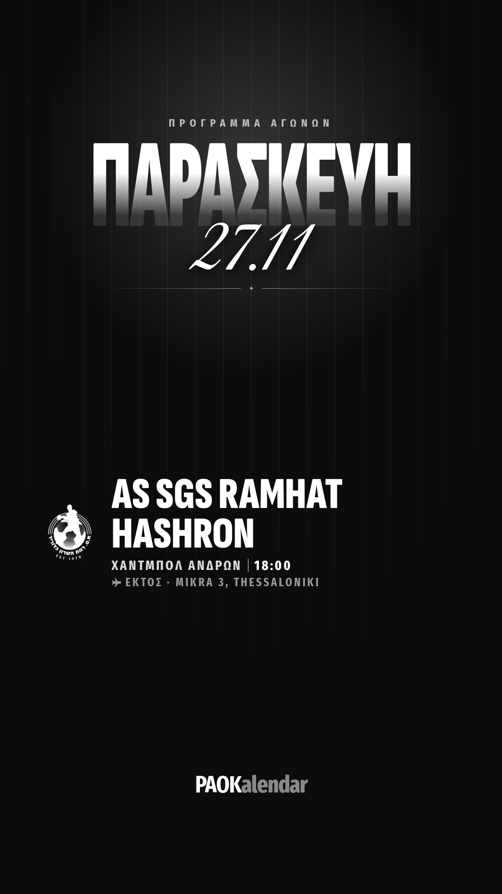
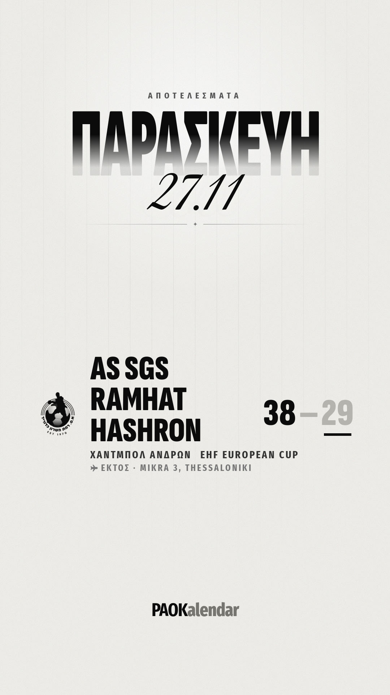
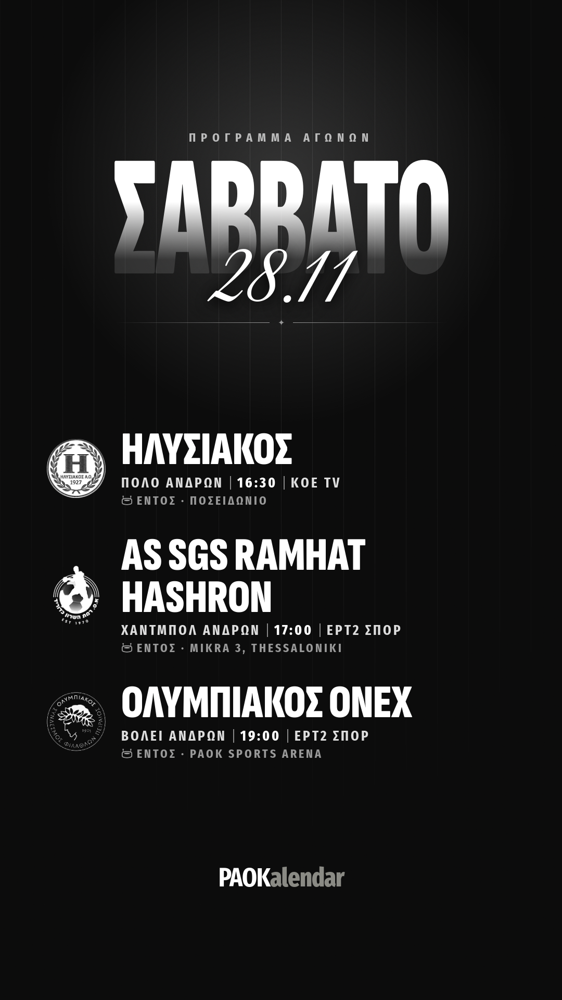
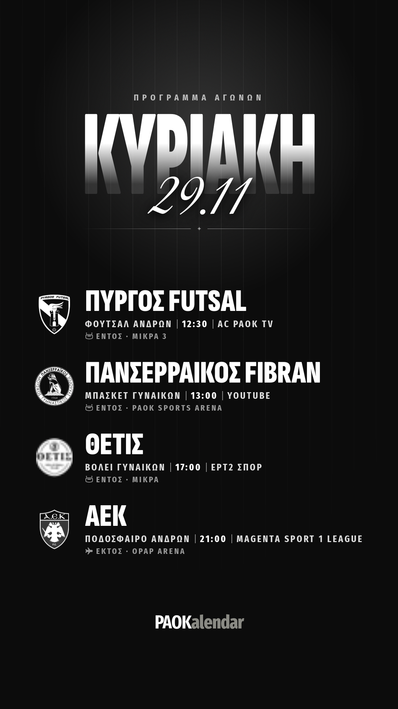
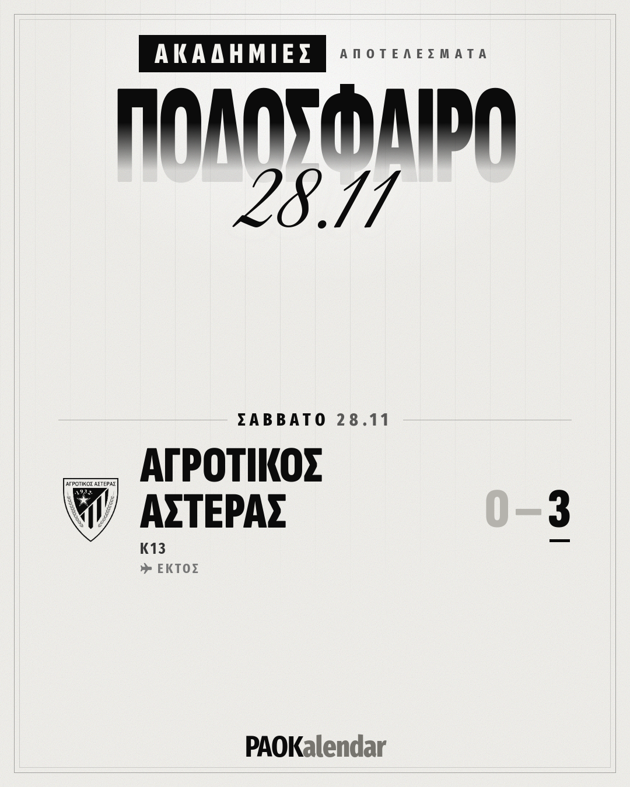
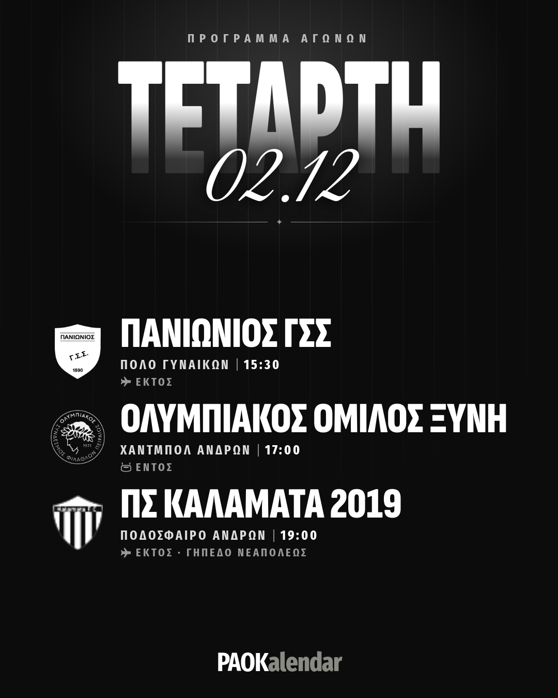
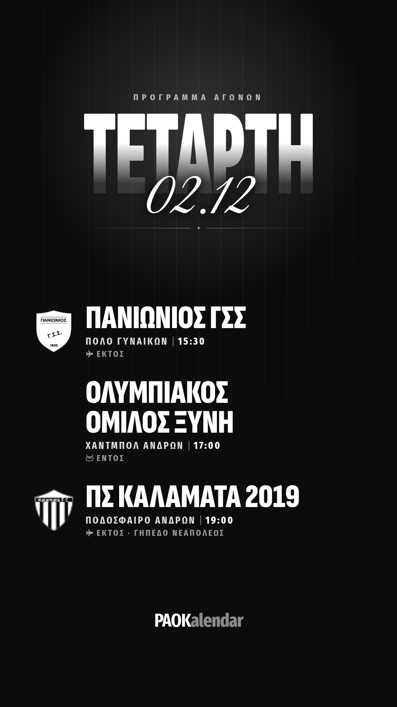

# Social: 28.11 – 04.12

Φτιάχνεται μόνο του μετά από κάθε ενημέρωση του προγράμματος (social.yml), οπότε δείχνει πάντα τις τελευταίες ώρες και αλλαγές. Στο iPhone (Safari): πάτα μια εικόνα, κράτα το δάχτυλο πάνω της → «Προσθήκη στις Φωτογραφίες».

## Παρασκευή 27.11

### 09:00 · ⭕ Story: Σήμερα παίζει

Sticker «Σύνδεσμος» → paokalendar.gr

<a href="https://raw.githubusercontent.com/GabrielChatzi/PAOK-calendar/social/img/2026-11-27-story.png"></a>

### 20:00 · ⭕ Story: Αποτελέσματα ημέρας

<a href="https://raw.githubusercontent.com/GabrielChatzi/PAOK-calendar/social/img/2026-11-27-apotelesmata-story.png"></a>

### 22:06 · ⭕ Story: Αλλαγή προγράμματος

Βγήκε: Ποδόσφαιρο Κ12: ΑΓΙΟΣ ΝΙΚΟΛΑΟΣ – ΠΑΟΚ, Σάβ 28.11 · Βγήκε: Ποδόσφαιρο Κ12 Κορασίδων: ΠΑΟΚ – ΛΕΟΝΤΕΣ (2), Σάβ 28.11 · Sticker «Σύνδεσμος» → paokalendar.gr. Αν θέλεις, πρόσθεσε και στο post τη νέα εικόνα (επεξεργασία carousel).

## Σάββατο 28.11 (σήμερα)

### 09:00 · ⭕ Story: Σήμερα παίζει

Sticker «Σύνδεσμος» → paokalendar.gr

<a href="https://raw.githubusercontent.com/GabrielChatzi/PAOK-calendar/social/img/2026-11-28-story.png"></a>

### 21:30 · ⭕ Story: Αποτελέσματα ημέρας

Οι εικόνες θα βγουν μόλις έρθουν τα σκορ.

## Κυριακή 29.11

### 09:00 · ⭕ Story: Σήμερα παίζει

Sticker «Σύνδεσμος» → paokalendar.gr

<a href="https://raw.githubusercontent.com/GabrielChatzi/PAOK-calendar/social/img/2026-11-29-story.png"></a>

### 23:30 · ⭕ Story: Αποτελέσματα ημέρας

Οι εικόνες θα βγουν μόλις έρθουν τα σκορ.

## Δευτέρα 30.11

### 08:30 · 📸 Post ⬜: Αποτελέσματα του Σαββατοκύριακου

Ακαδημίες χωρίς σκορ ακόμα: 17

Λείπει ακόμα το σκορ: ΠΑΟΚ – ΗΛΥΣΙΑΚΟΣ ΑΟ, ΠΑΟΚ – AS SGS Ramhat Hashron, ΠΑΟΚ – Ολυμπιακός Σ.Φ.Π. ONEX, ΠΑΟΚ – ΠΥΡΓΟΣ FUTSAL, ΠΑΟΚ – ΠΑΝΣΕΡΡΑΙΚΟΣ FIBRAN, ΠΑΟΚ – Α.Σ.Π. Θέτις, ΑΕΚ – ΠΑΟΚ. Θα μπει μόλις έρθει.

<a href="https://raw.githubusercontent.com/GabrielChatzi/PAOK-calendar/social/img/akadimies-2026-11-28-football-apotelesmata-post.png"></a>

```
Τα αποτελέσματα των ακαδημιών ⚪️⚫️
1 νίκη σε 1 αγώνα. Μπράβο σε όλα τα παιδιά! 👏

Το παιδί σου παίζει στις ακαδημίες του ΠΑΟΚ; Βάλε τους αγώνες της ομάδας του στο ημερολόγιο του κινητού, με ειδοποιήσεις και βαθμολογία: paokalendar.gr → Ακαδημίες (link στο bio)

#ΠΑΟΚ #PAOK #PAOKAcademy #PAOKalendar
```

## Τρίτη 01.12

### 09:00 · 📸 Post ⬛: Πρόγραμμα της εβδομάδας

<a href="https://raw.githubusercontent.com/GabrielChatzi/PAOK-calendar/social/img/2026-12-02-post.png"></a>

```
Η εβδομάδα του ΠΑΟΚ σε όλα τα τμήματα ⚪️⚫️
3 αγώνες σε 3 αθλήματα, την Τετάρτη, με το ΠΣ ΚΑΛΑΜΑΤΑ 2019–ΠΑΟΚ την Τετάρτη στις 19:00.

Ώρες, κανάλια και ειδοποιήσεις για κάθε αγώνα: paokalendar.gr (link στο bio)

#ΠΑΟΚ #PAOK #PAOKalendar
```

## Τετάρτη 02.12

### 09:00 · ⭕ Story: Σήμερα παίζει

Sticker «Σύνδεσμος» → paokalendar.gr

<a href="https://raw.githubusercontent.com/GabrielChatzi/PAOK-calendar/social/img/2026-12-02-story.png"></a>

### 21:30 · 📸 Post ⬜: Αποτελέσματα της εβδομάδας

Οι εικόνες θα βγουν μόλις έρθουν τα σκορ.

### 21:30 · ⭕ Story: Αποτελέσματα ημέρας

Οι εικόνες θα βγουν μόλις έρθουν τα σκορ.

## Πέμπτη 03.12

### 19:00 · 📸 Post ⬛: Βαθμολογίες

Οι βαθμολογίες όλων των τμημάτων που παίζουν σε πρωτάθλημα, μία κάρτα ανά τμήμα.

⬛ Σκούρο σχέδιο. Η εικόνα δεν βγαίνει ακόμα αυτόματα.

```
Πού βρίσκεται ο ΠΑΟΚ σε κάθε άθλημα; 📊

Όλα σε μία εφαρμογή: paokalendar.gr (link στο bio)

#ΠΑΟΚ #PAOK #PAOKalendar
```

## Παρασκευή 04.12

### 19:00 · 🎬 Reel ⬜: Πώς βάζεις ειδοποίηση για έναν αγώνα

Εγγραφή οθόνης: άνοιγμα εφαρμογής → αγώνας → «Ειδοποιήσεις» → «1 ώρα πριν» και «Live».

Εξώφυλλο ⬜ ανοιχτό, για να κρατήσει η σκακιέρα στο grid.

```
Μάθε για κάθε γκολ πριν το δεις στην τηλεόραση ⚽🔔
Σε 10'' από το κινητό σου, χωρίς λογαριασμό.

Δωρεάν στο paokalendar.gr (link στο bio)

#ΠΑΟΚ #PAOK #PAOKalendar
```
